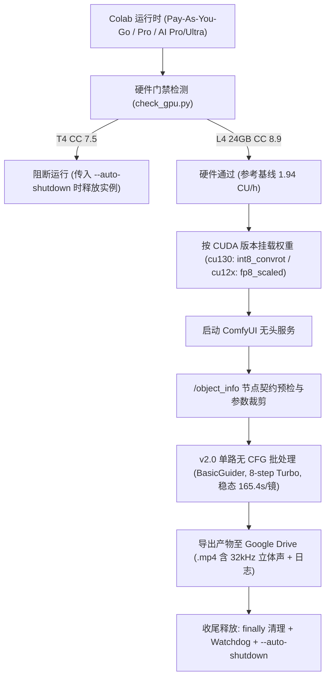

# minimax-h3-colab-workflow

在 Google Colab（推荐 L4 24GB）上使用开源权重运行 MiniMax H3（视频与原生立体声）及 MiniMax-H3-Image（文生图与指令修图）的工作流合集。全流程不调用 MiniMax 商业 API，直接加载 Comfy-Org 量化权重与 `stable-diffusion.cpp` 执行推理；云端运行时仍按 Google Colab 计算单元（CU）实时面板扣费。

> 计费口径提示：下文涉及的外部资费与榜单信息核对日期为 **2026-11-12**，以各官网及 Colab 实时计费面板为准；详细数据出处见 [docs/minimax-h3-facts-2026-11-12.md](docs/minimax-h3-facts-2026-11-12.md)。

---

## 核心工程设计

1. **单路无 CFG 推理（`BasicGuider`, `CFG=1.0`）**
   - 针对已完成 CFG 蒸馏的 Pruned 模型与 Turbo LoRA，取消正负双路 `CLIPTextEncode` 与 `KSampler (cfg=3.0)`，改为 `MiniMaxH3ImageToVideo` -> `BasicGuider` -> `SamplerCustomAdvanced`。
   - 8 步采样仅执行 8 次 DiT 前向传播。在 `960×544`、124 帧（24fps）下，相比 `v1.0` 同分辨率 `CFG=3.0` 实测（`315.8s` 无声 WebP），`v2.0` 稳态耗时降至 `165.4s`（`-47.6%`），同时输出 32kHz 双声道 `.mp4`。
2. **按 CUDA 版本适配量化权重**
   - `int8_convrot` 内核依赖 PyTorch `cu130` 与 `comfy-kitchen`。检测到 `CUDA >= 13.0` 时选用 `int8_convrot`；处于 `CUDA 12.x` 时自动切换为 `fp8_scaled`（DiT）+ `video_vae_fp16`（VAE），适配 L4（Ada CC 8.9）原生 FP8 硬件加速。
3. **4-Step / 8-Step Turbo LoRA 参数切换**
   - **8-Step（默认）**：已作为生产主路径完成 L4 实测（稳态 `165.4s` / 约 `0.089 CU/镜`）。
   - **4-Step（参数已接入）**：`download_models.py`、`agent_colab_runner.py`、`test_shanghai_mp4.py` 均支持 `--turbo-steps 4`，但尚未在 L4 上完成同条件成对实测，暂不给出耗时数字。
4. **节点契约预检与帧数网格对齐**
   - [scripts/batch_runner.py](scripts/batch_runner.py) 在提交工作流前拉取 `/object_info`，移除当前 ComfyUI 版本不支持的非必需字段；同时自动将帧数向上对齐至 `17k + 5`（如 `121 -> 124` 帧）。

---

## 运行约束与实测基准

| 项目 | 仓库实测记录与约束说明 |
|---|---|
| **GPU 门槛** | 要求 CUDA Compute Capability >= `8.0`（如 L4 24GB `sm_89`）。T4（`7.5`）缺少量化算子支持，[scripts/check_gpu.py](scripts/check_gpu.py) 会阻断运行；CLI 传入 `--auto-shutdown`（或 `v2.0` Notebook `AUTO_SHUTDOWN = True`）时调用 `runtime.unassign()` 释放实例。 |
| **L4 视频基准（`v2_0` 存证）** | 规格：`960×544`、124 帧、24fps、8 步 Turbo、`BasicGuider`。首镜冷启动 `243.5s`，后两镜稳态 `165.3s` / `165.5s`（均值 `165.4s`）；3 镜总计 `574.6s`，日志记录消耗 `0.309 CU`（面板基线 `1.94 CU/h`，折算稳态约 `0.089 CU/镜`、含冷启三镜均摊约 `0.103 CU/镜`）。冷启、下载、空闲与返工另计，不构成月产量保证；外部资费与实时 CU 扣费率以 Colab 官网及当前面板为准。 |
| **显存参考（`v1_0` 烟测）** | `v1_0` 在 `960×544` 烟测下 `nvidia-smi` 记录去噪稳态显存 `21.77 GB`、峰值 `21.91 GB`（该次 L4 可用 `22.03 GB`，余量 `0.12 GB`）；切换至 `1344×768` 时耗时升至 `874.1~875.4s`，故生产基准锁定为 `960×544`。 |
| **L4 图像基准（`v4_0` 存证）** | 使用 `stable-diffusion.cpp` (`sd-cli`)、`2048×2048`、6 步 PDD、`CFG=1.0`：文生图 `157.8s`（约 `0.085 CU`），基于 `<Picture 1>` 指令修图 `226.1s`（约 `0.122 CU`）。 |
| **模型拉取与 Drive 缓存** | `v2.0`/`v4.0` Colab Notebook 优先从 HuggingFace 直拉到本地 NVMe 并备份/回退 Google Drive；独立脚本 [scripts/download_models.py](scripts/download_models.py) 优先检测并复用 Drive 缓存后再回退 HuggingFace 直拉。 |
| **推荐采样配置** | 视频使用 `KSamplerSelect (res_multistep)` + `BasicScheduler (simple)` + `BasicGuider (cfg=1.0)`；图像使用 `sd-cli` `--sampling-method euler --sigmas minimax-h3-image --cfg-scale 1.0 --steps 6`。 |

---

## 快速开始

### 方式 A：在 Google Colab 交互运行

1. 打开生产笔记本：[v2.0 视频生成模板](notebooks/v2.0_minimax_h3_l4_production_mp4.ipynb) 或 [v4.0 图像与修图模板](notebooks/v4.0_minimax_h3_image_colab_demo.ipynb)。
2. 运行时类型选择 **GPU -> L4（高内存）**。
3. 依次运行全部单元格并在提示时授权 Google Drive 挂载。
4. `v2.0` 模板默认开启 `AUTO_SHUTDOWN = True`，导出 MP4 后自动调用 `runtime.unassign()`；`v4.0` 模板默认 `AUTO_SHUTDOWN = False` 以便检查生成图，使用完毕请手动释放运行时或改为 `True`。

### 方式 B：通过 Colab MCP + Agent 批量执行

配置与说明见 [docs/COLAB_MCP_INTEGRATION.md](docs/COLAB_MCP_INTEGRATION.md)。在 Colab 实例内可直接执行：

```bash
python scripts/agent_colab_runner.py \
    --workflow workflows/h3_t2v_pdd8_production.json \
    --prompts configs/story_cyber_dawn.json \
    --output /content/drive/MyDrive/MiniMax_Outputs \
    --auto-shutdown
```

### 方式 C：MiniMax-H3-Image 多后端脚本

支持 `sdcpp`（默认）、`comfyui` 与 `diffusers`，无 GPU 时可用 `--dry-run` 预检参数与命令组装：

```bash
python3 scripts/demo_h3_image.py --backend sdcpp --dry-run
```

---

## 流程与节点拓扑

### 执行流程



### ComfyUI 2.0 原生 15 节点拓扑

```
[1] UNETLoader (minimax_h3_fl2va_pruned_fp8_scaled / int8_convrot)
 └──> [10] LoraLoaderModelOnly (minimax_h3_fl2v_turbo_8step / 4step)
       ├──> [7] BasicGuider (CFG=1.0) <── conditioning ── [6] MiniMaxH3ImageToVideo <── [2] CLIPLoader (Qwen3-VL 32B NVFP4)
       │         │                                               │                      └── [4] VAELoader (Video VAE)
       │         │                                         latent_image
       │         ▼                                               │
       │    [3] SamplerCustomAdvanced <──────────────────────────┘
       │         ├── noise <── [14] RandomNoise (seed)
       │         ├── sampler <── [15] KSamplerSelect (res_multistep)
       │         └── sigmas <── [16] BasicScheduler (steps: 8, scheduler: simple)
       │
       ├──> [8] VAEDecode (Video) <── vae ── [4] VAELoader
       └──> [12] VAEDecodeAudio (Audio) <── vae ── [11] VAELoader (32kHz Stereo FP32)
                 │                                        │
                 ▼                                        ▼
             [13] CreateVideo (24.0 fps) ──────────> [9] SaveVideo (.mp4)
```

---

## 仓库目录

### Notebooks（见 [notebooks/README.md](notebooks/README.md)）
- [v2_0_minimax_h3_l4_production_mp4.ipynb](notebooks/v2_0_minimax_h3_l4_production_mp4.ipynb) — 视频生产实测存证版（含 3 镜 `574.6s`、稳态 `165.4s/镜`、`0.309 CU` 消耗与预览日志）。
- [v2.0_minimax_h3_l4_production_mp4.ipynb](notebooks/v2.0_minimax_h3_l4_production_mp4.ipynb) — 视频生产干净模板（单路无 CFG、自适应权重、默认 `AUTO_SHUTDOWN = True`）。
- [v2.0_test_shanghai_street_mp4.ipynb](notebooks/v2.0_test_shanghai_street_mp4.ipynb) — 上海街景 3 镜测试模板。
- [v4_0_minimax_h3_image_colab_demo.ipynb](notebooks/v4_0_minimax_h3_image_colab_demo.ipynb) — MiniMax-H3-Image 实测存证版（免 ComfyUI，`sd-cli` 6 步 `2048×2048` 文生图与修图完整输出）。
- [v4.0_minimax_h3_image_colab_demo.ipynb](notebooks/v4.0_minimax_h3_image_colab_demo.ipynb) — MiniMax-H3-Image 干净模板（HF 直连 NVMe、sd-cli 编译缓存恢复、2 小时看门狗）。
- [v1_0_minimax_h3_l4_benchmark_webp.ipynb](notebooks/v1_0_minimax_h3_l4_benchmark_webp.ipynb) / [v1.0_minimax_h3_l4_benchmark_webp.ipynb](notebooks/v1.0_minimax_h3_l4_benchmark_webp.ipynb) — `v1.0` WebP 基准存证与模板（`960×544` 与 `1344×768` 对照）。
- [v1.5_minimax_h3_l4_legacy_mp4.ipynb](notebooks/v1.5_minimax_h3_l4_legacy_mp4.ipynb) — 历史双路 `CFG=3.0` 模板对照（未保留云端运行输出）。

### 核心脚本
- [scripts/agent_colab_runner.py](scripts/agent_colab_runner.py) — Colab Agent 一体化执行入口（环境检卡、权重拉取、批渲染、`--auto-shutdown` 释放实例）。
- [scripts/check_gpu.py](scripts/check_gpu.py) — GPU 算力（`>= 8.0`）、显存与磁盘预检。
- [scripts/download_models.py](scripts/download_models.py) — 权重下载与校验（支持 `--variant` / `--turbo-steps`，CLI 模式先检查 Drive 缓存再回退 HuggingFace，校对精确字节与 safetensors 头部）。
- [scripts/batch_runner.py](scripts/batch_runner.py) — 无头批处理渲染器（`BasicGuider`、`format_h3_prompt`、`align_frame_count` 与 `/object_info` 校验）。
- [scripts/demo_h3_image.py](scripts/demo_h3_image.py) — MiniMax-H3-Image 独立多后端调度脚本（`sdcpp` / `comfyui` / `diffusers`）。

### 工作流与配置模板
- [workflows/h3_t2v_pdd8_production.json](workflows/h3_t2v_pdd8_production.json) / [workflows/h3_t2v_pdd8_webp.json](workflows/h3_t2v_pdd8_webp.json) — `v2.0` 8 步无 CFG 工作流（MP4 与 WebP）。
- [configs/prompts.example.json](configs/prompts.example.json)、[configs/shanghai_street.json](configs/shanghai_street.json)、[configs/story_cyber_dawn.json](configs/story_cyber_dawn.json) — T2VA 排期与分镜脚本示例。
- [configs/templates/](configs/templates/) — V3 多模态模板（`I2V` / `FLF2V` / `Ref2VA`）；其引用的 `outputs/showcase/` 示例素材被 `.gitignore` 忽略，使用前可先运行 `python3 scripts/generate_showcase_assets.py` 在本地生成预览基准素材。

### 文档与实战文章
- [docs/minimax-h3-facts-2026-11-12.md](docs/minimax-h3-facts-2026-11-12.md) — 外部资费、榜单与仓库实测台账。
- [docs/RESEARCH_SUMMARY.md](docs/RESEARCH_SUMMARY.md) — 开源方案对比与 `v2.0` 实测分析。
- [docs/COLAB_MCP_INTEGRATION.md](docs/COLAB_MCP_INTEGRATION.md) — `googlecolab/colab-mcp` 接入与配置说明。
- [docs/PROMPT_RECIPES.md](docs/PROMPT_RECIPES.md) — 结构化多镜头与环境音提示词示例。
- [docs/REFERENCES.md](docs/REFERENCES.md) — 开源生态项目借鉴与落地记录。
- [docs/ROADMAP.md](docs/ROADMAP.md) — 工程演进计划。
- 实战文章：[篇一：MiniMax H3（海螺 3.0），开源视频生成模型，技术定位与选型对比](docs/articles/01-introduction-and-principles.md) ｜ [篇二：基准工作流与关键参数影响](docs/articles/02-timeline-prompting.md) ｜ [篇三：MiniMax-H3-Image 与 sd.cpp 直出](docs/articles/03-minimax-h3-image-deepdive-and-colab.md)
