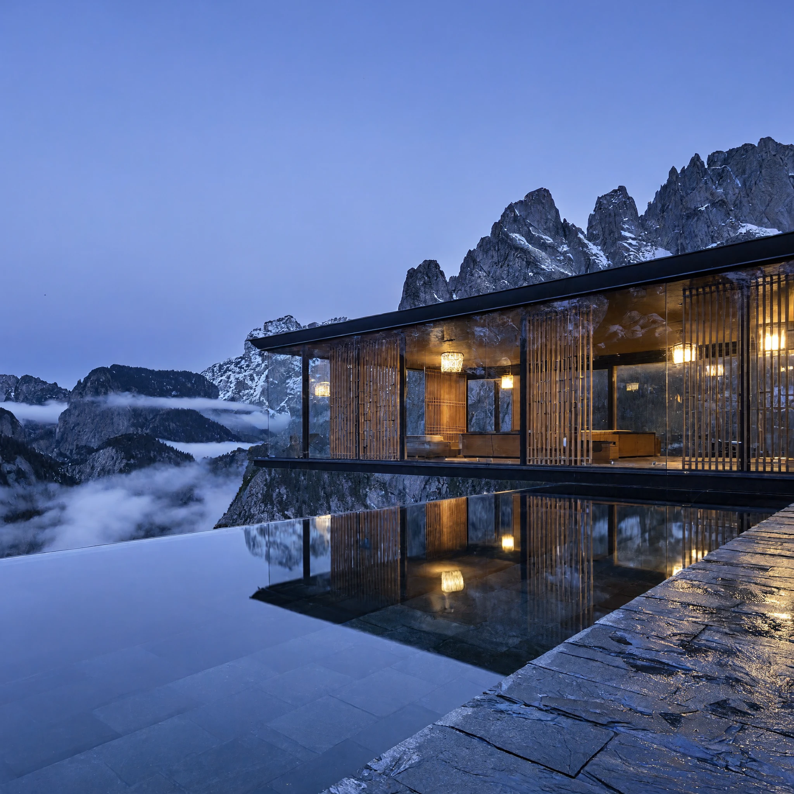

<div align="center">

# MiniMax H3 Colab Workflows

**Run MiniMax H3 (Video + 32kHz Stereo Audio) & MiniMax-H3-Image locally on a single Google Colab L4 24GB GPU — using open weights, zero commercial API calls.**

[English](README.md) | [中文](README_ZH.md)

[](https://colab.research.google.com/github/kuhung/minimax-h3-colab-workflow/blob/main/notebooks/v2.0_minimax_h3_l4_production_mp4.ipynb)
[](LICENSE)
[](#quick-launch)

</div>

<p align="center">
  
</p>
<p align="center">
  
  
</p>

<p align="center">
  <sub>Top: real <code>v5_0</code> L4 render (960×544, 24fps, native 32kHz stereo audio in notebook). Bottom: real <code>v4_0</code> 2048×2048 text-to-image (157.8s) and instruction edit (226.1s).</sub>
</p>

---

### At a Glance (Measured on Colab L4 24GB)

| Metric | Video + Stereo Audio (`v2.0` 8-step Turbo) | Image Gen / Edit (`v4.0` 6-step PDD) |
|---|---|---|
| **GPU Requirement** | NVIDIA L4 24GB (CUDA CC ≥ 8.0; T4 blocked) | NVIDIA L4 24GB (`stable-diffusion.cpp`) |
| **Resolution & Output** | `960×544`, 124 frames, 24fps `.mp4` + 32kHz stereo | `2048×2048` `.png` (T2I & `<Picture 1>` edit) |
| **Steady Runtime** | **165.4s / clip** (`-47.6%` vs. CFG=3.0 dual-pass) | **157.8s** (T2I) · **226.1s** (instruction edit) |
| **Est. Colab Cost** | **~0.089 CU / steady clip** *(at 1.94 CU/h)* | **~0.085–0.122 CU / image** *(excl. setup/idle)* |

---

## Quick Launch

Select **Runtime → Change runtime type → L4 GPU**, then run cells in order.

| Workflow | What it does | Launch | Recorded Output |
|---|---|---|---|
| **Text-to-Video + Audio (`v2.0`)** | Single-pass `CFG=1.0` 8-step Turbo MP4 with stereo audio | [](https://colab.research.google.com/github/kuhung/minimax-h3-colab-workflow/blob/main/notebooks/v2.0_minimax_h3_l4_production_mp4.ipynb) | [Pre-run log](notebooks/v2_0_minimax_h3_l4_production_mp4.ipynb) |
| **Image-to-Video (`v3.1` I2V)** | Lock product / subject appearance from a first frame | [](https://colab.research.google.com/github/kuhung/minimax-h3-colab-workflow/blob/main/notebooks/v3.1_minimax_h3_i2v.ipynb) | [Pre-run log](notebooks/v3_1_minimax_h3_i2v.ipynb) |
| **First-Last Frame (`v3.2` FLF2V)** | Control both start and end transition frames | [](https://colab.research.google.com/github/kuhung/minimax-h3-colab-workflow/blob/main/notebooks/v3.2_minimax_h3_flf2v.ipynb) | [Pre-run log](notebooks/v3_2_minimax_h3_flf2v.ipynb) |
| **Multimodal Ref (`v3.3` Ref2VA)** | Combine image, video, and audio references | [](https://colab.research.google.com/github/kuhung/minimax-h3-colab-workflow/blob/main/notebooks/v3.3_minimax_h3_ref2va.ipynb) | [Pre-run log](notebooks/v3_3_minimax_h3_ref2va.ipynb) |
| **H3-Image Gen & Edit (`v4.0`)** | 2048×2048 text-to-image and instruction editing via `sd-cli` | [](https://colab.research.google.com/github/kuhung/minimax-h3-colab-workflow/blob/main/notebooks/v4.0_minimax_h3_image_colab_demo.ipynb) | [Pre-run log](notebooks/v4_0_minimax_h3_image_colab_demo.ipynb) |
| **3-Shot Storyboard (`v5.0`)** | Final-frame continuation across 3 shots with audio crossfade | [](https://colab.research.google.com/github/kuhung/minimax-h3-colab-workflow/blob/main/notebooks/v5.0_minimax_h3_watch_storyboard.ipynb) | [Pre-run log](notebooks/v5_0_minimax_h3_watch_storyboard.ipynb) |

> **Auto-shutdown safety:** `v2.0` enables `AUTO_SHUTDOWN = True` by default to release the L4 instance after exporting to Google Drive. `v4.0` defaults to `False` so you can inspect images first—remember to disconnect manually when finished.

---

## Why This Workflow Exists

- **Single-pass `CFG=1.0` sampling (`BasicGuider`)**: Cuts DiT forward passes in half for distilled Pruned + Turbo LoRA weights, dropping 544p runtime from `315.8s` to `165.4s` while adding 32kHz stereo audio.
- **CUDA-aware quantization**: Automatically picks `int8_convrot` on CUDA ≥ 13.0 and `fp8_scaled` + `video_vae_fp16` on CUDA 12.x (native Ada FP8 on L4).
- **Pre-flight guards**: `check_gpu.py` blocks unsupported T4 GPUs before wasting CU; `batch_runner.py` inspects ComfyUI `/object_info` to strip schema mismatches and aligns frame counts to `17k + 5`.
- **Colab MCP & CLI batch automation**: Run headless multi-shot batches with Drive caching and automatic runtime teardown.

---

## CLI & Agent Batch Usage

Run headless multi-shot rendering inside a Colab instance (see [Colab MCP integration](docs/COLAB_MCP_INTEGRATION.md)):

```bash
python scripts/agent_colab_runner.py \
    --workflow workflows/h3_t2v_pdd8_production.json \
    --prompts configs/prompts.example.json \
    --output /content/drive/MyDrive/MiniMax_Outputs \
    --auto-shutdown
```

Preview the multi-backend image CLI (`sdcpp` / `comfyui` / `diffusers`) locally without a GPU:

```bash
python3 scripts/demo_h3_image.py --backend sdcpp --dry-run
```

---

<details>
<summary><strong>Full L4 Benchmark Table, VRAM Headroom & Billing Notes (checked 2026-11-12)</strong></summary>

| Workflow | Configuration | Recorded Runtime | Estimated CU *(at 1.94 CU/h)* |
|---|---|---|---|
| `v2_0` T2V | 960×544, 124f, 24fps, 8-step, BasicGuider | Cold start 243.5s; steady 165.3 / 165.5s (mean **165.4s**); 3 shots 574.6s | ~0.089 CU/steady shot (~0.309–0.310 CU for 3 shots) |
| `v1_0` VRAM baseline | 960×544, CFG=3.0; L4 22.03 GB | 393.8s; denoising 21.77 GB, peak 21.91 GB (0.12 GB headroom) | 1344×768 took 874.1–875.4s (near 900s timeout) |
| `v3_1` I2V | 960×544, 124f, 24fps, 8-step | First shot 258.1s *(incl. model load)* | ~0.139 CU |
| `v3_2` FLF2V | 960×544, 124f, 24fps, 8-step | First shot 273.2s *(incl. model load)* | ~0.147 CU |
| `v3_3` Ref2VA | 960×544, 124f, 24fps, 4-step | First shot 369.2s *(incl. model load)* | ~0.199 CU |
| `v4_0` Image | `sd-cli`, 2048×2048, 6-step PDD, CFG=1.0 | T2I 157.8s; `<Picture 1>` edit 226.1s | ~0.085 / ~0.122 CU |
| `v5_0` Watch 3-shot | 3 connected shots, final-frame continuation | 265.4 / 183.5 / 195.2s (total ~644.1s, 373f / 15.54s MP4) | ~0.347 CU |

- All CU estimates exclude setup, model downloads, and idle time; your live Google Colab meter governs actual billing.
- 4-step Turbo is wired into the CLI (`--turbo-steps 4`) but has not yet been paired-benchmarked against 8-step on L4.
- Full verification log: [docs/minimax-h3-facts-2026-11-12.md](docs/minimax-h3-facts-2026-11-12.md).

</details>

<details>
<summary><strong>Repository Guide & ComfyUI 15-Node Topology</strong></summary>

```text
[1] UNETLoader (minimax_h3_fl2va_pruned_fp8_scaled / int8_convrot)
 └──> [10] LoraLoaderModelOnly (minimax_h3_fl2v_turbo_8step / 4step)
       ├──> [7] BasicGuider (CFG=1.0) <── conditioning ── [6] MiniMaxH3ImageToVideo <── [2] CLIPLoader (Qwen3-VL 32B NVFP4)
       │         ▼                                                                       └── [4] VAELoader (Video VAE)
       │    [3] SamplerCustomAdvanced (RandomNoise + res_multistep + simple 8-step)
       ├──> [8] VAEDecode (Video) ──────┐
       └──> [12] VAEDecodeAudio (32kHz) ┴──> [13] CreateVideo (24fps) ──> [9] SaveVideo (.mp4)
```

- **Notebooks**: [notebooks/README.md](notebooks/README.md) (clean templates + pre-run examples with embedded outputs)
- **Scripts**: [agent_colab_runner.py](scripts/agent_colab_runner.py), [batch_runner.py](scripts/batch_runner.py), [check_gpu.py](scripts/check_gpu.py), [download_models.py](scripts/download_models.py), [demo_h3_image.py](scripts/demo_h3_image.py)
- **Workflows & Configs**: [workflows/](workflows/), [configs/prompts.example.json](configs/prompts.example.json), [configs/templates/](configs/templates/)
- **Deep-Dive Articles (ZH)**: [01 Model Positioning](docs/articles/01-introduction-and-principles.md) · [02 Parameters & Baseline](docs/articles/02-timeline-prompting.md) · [03 H3-Image & sd.cpp](docs/articles/03-minimax-h3-image-deepdive-and-colab.md)
- **Docs**: [RESEARCH_SUMMARY.md](docs/RESEARCH_SUMMARY.md) · [PROMPT_RECIPES.md](docs/PROMPT_RECIPES.md) · [REFERENCES.md](docs/REFERENCES.md) · [ROADMAP.md](docs/ROADMAP.md)

</details>

---

## Contributing, Related Tools & License

- Found a bug or benchmarked another GPU? Open a [Bug Report](https://github.com/kuhung/minimax-h3-colab-workflow/issues/new?template=bug_report.yml) or [GPU Benchmark Report](https://github.com/kuhung/minimax-h3-colab-workflow/issues/new?template=benchmark_report.yml).
- Comparing self-hosted GPU costs vs. commercial model APIs? Check out [TrakToken](https://www.traktoken.com) for live pricing and benchmarks across 700+ models.
- Code is licensed under [MIT](LICENSE). MiniMax weights and third-party components retain their own licenses—see the [MiniMax H3 Community License](https://huggingface.co/MiniMaxAI/MiniMax-H3/blob/main/LICENSE).
