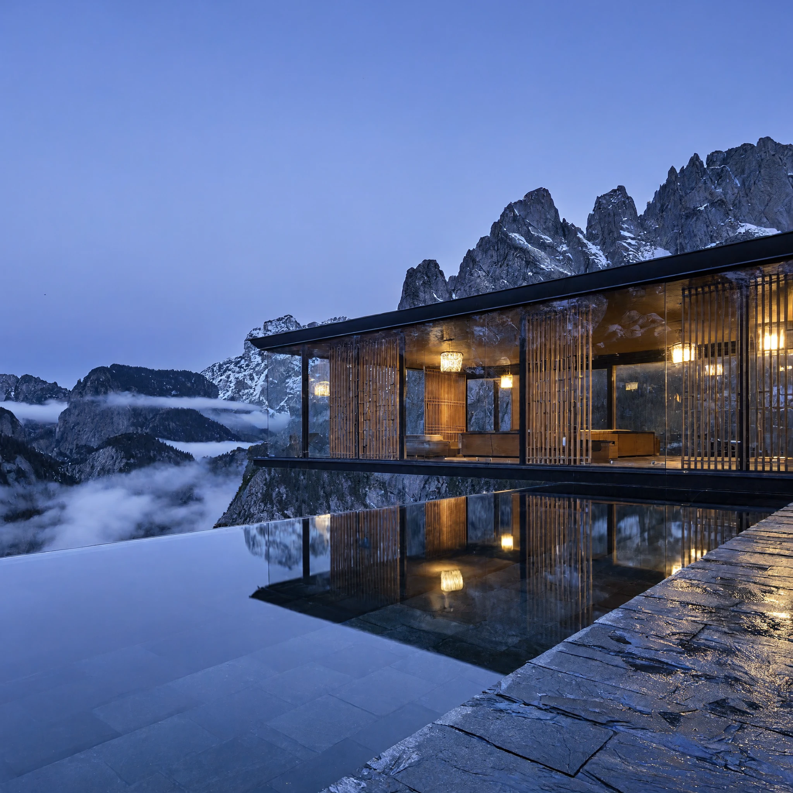

[中文](README.md) | [English](README_EN.md)

# minimax-h3-colab-workflow

Run MiniMax H3 video with native stereo audio and MiniMax-H3-Image generation/editing on Google Colab, using quantized open weights. Choose an L4 GPU runtime and run notebook cells in order. Colab bills the runtime in Compute Units (CU).

<p>
  
  
</p>

> Recorded `v4_0` outputs (`2048×2048`, 6 PDD steps): text-to-image on the left (`157.8s`), `<Picture 1>` instruction edit on the right (`226.1s`). Video and multi-shot renders are embedded in the pre-run example notebooks below.

## Quick Launch by Use Case

| Use case | Template | Launch |
|---|---|---|
| Text to video with audio | [v2.0](notebooks/v2.0_minimax_h3_l4_production_mp4.ipynb) | [](https://colab.research.google.com/github/kuhung/minimax-h3-colab-workflow/blob/main/notebooks/v2.0_minimax_h3_l4_production_mp4.ipynb) |
| Animate a first-frame image (I2V) | [v3.1](notebooks/v3.1_minimax_h3_i2v.ipynb) | [](https://colab.research.google.com/github/kuhung/minimax-h3-colab-workflow/blob/main/notebooks/v3.1_minimax_h3_i2v.ipynb) |
| Control start and end frames (FLF2V) | [v3.2](notebooks/v3.2_minimax_h3_flf2v.ipynb) | [](https://colab.research.google.com/github/kuhung/minimax-h3-colab-workflow/blob/main/notebooks/v3.2_minimax_h3_flf2v.ipynb) |
| Combine image, video and audio references (Ref2VA) | [v3.3](notebooks/v3.3_minimax_h3_ref2va.ipynb) | [](https://colab.research.google.com/github/kuhung/minimax-h3-colab-workflow/blob/main/notebooks/v3.3_minimax_h3_ref2va.ipynb) |
| Generate and edit images (H3-Image) | [v4.0](notebooks/v4.0_minimax_h3_image_colab_demo.ipynb) | [](https://colab.research.google.com/github/kuhung/minimax-h3-colab-workflow/blob/main/notebooks/v4.0_minimax_h3_image_colab_demo.ipynb) |
| Three-shot watch film (final-frame continuation) | [v5.0](notebooks/v5.0_minimax_h3_watch_storyboard.ipynb) | [](https://colab.research.google.com/github/kuhung/minimax-h3-colab-workflow/blob/main/notebooks/v5.0_minimax_h3_watch_storyboard.ipynb) |

Video templates default to 960×544; the Image template defaults to 2048×2048.

Metrics below come from repository execution logs checked on **2026-11-12**; see [docs/minimax-h3-facts-2026-11-12.md](docs/minimax-h3-facts-2026-11-12.md). CU estimates use the historical 1.94 CU/h rate and exclude setup, downloads, and idle time; your live Colab meter governs billing.

## Engineering choices

- **Single-pass sampling:** `BasicGuider`, CFG=1.0, `res_multistep`, and `simple`, with 8-step Turbo as the T2V baseline. The earlier `v1_0` 960×544 CFG=3.0 WebP shot took 315.83s; `v2_0` steady MP4 shots averaged 165.4s (47.6% faster, with 32kHz stereo audio added).
- **CUDA-aware weights:** INT8 ConvRot on CUDA 13+, and FP8 scaled with FP16 video VAE on CUDA 12.x.
- **4-step option:** supported by the scripts, though no paired L4 4-step vs. 8-step T2V comparison is recorded yet. Ref2VA has a separate 4-step first-shot observation below.
- **Workflow checks:** the batch runner inspects `/object_info` to strip unrecognized optional fields before submission, while keeping semantic and reference inputs intact. Frame counts align upward to `17k + 5` (e.g., 121 becomes 124).

## Verified L4 observations

| Workflow | Configuration | Recorded elapsed time | Estimated CU |
|---|---|---|---|
| v2_0 T2V | 960×544, 124 frames, 24fps, 8 steps, BasicGuider | Cold start 243.5s; steady 165.3 / 165.5s, mean **165.4s**; three shots 574.6s | ~0.0891 CU/steady shot at 1.94 CU/h (raw log ~0.303 CU at 1.90 CU/h; calibrated three-shot total ~0.309–0.310 CU, ~0.103 CU/shot including cold start) |
| v1_0 VRAM check | 960×544, CFG=3.0; L4 capacity 22.03 GB | 393.78s; denoising 21.77 GB, peak 21.91 GB, headroom 0.12 GB | Separate from v2_0; older 1344×768 shots took 874.08 / 875.35s |
| v3_1 I2V | 960×544, 124 frames, 24fps, 8 steps | First shot 258.1s | ~0.1391 CU |
| v3_2 FLF2V | Same video size/frame count, 8 steps | First shot 273.2s | ~0.1472 CU |
| v3_3 Ref2VA | Same video size/frame count, 4 steps | First shot 369.2s | ~0.1990 CU |
| v4_0 Image | sd-cli, 2048×2048, 6 steps, CFG=1.0 | Text-to-image 157.8s; instruction edit 226.1s | ~0.085 / ~0.122 CU |
| v5_0 Watch Storyboard | Three connected shots, previous final-frame continuation | 265.4 / 183.5 / 195.2s, total ~644.1s including output checks and Drive saves | ~0.3471 CU |

V3 values are single first-shot runs that include model loading (L4 capacity 22.49 GB; peak VRAM was not recorded). V5 produced H.264 960×544, 373 frames (15.54s) with AAC 32kHz stereo audio. Native audio crossfades between shots ran as expected; a single background music track has not been tested yet. Spot checks at 1-second intervals confirmed camera transitions (frame-by-frame continuity was not audited; the final clip has 373 frames instead of the 372-frame sum).

## Run the workflows

**In Colab:** click a launch badge above, choose **GPU -> L4 (high memory)**, and authorize Drive when prompted. V2 defaults to `AUTO_SHUTDOWN = True`; V4 defaults to `False` so you can inspect images first (release the runtime manually when done).

**With an Agent:** see [Colab MCP integration](docs/COLAB_MCP_INTEGRATION.md). Inside Colab:

```bash
python scripts/agent_colab_runner.py \
    --workflow workflows/h3_t2v_pdd8_production.json \
    --prompts configs/prompts.example.json \
    --output /content/drive/MyDrive/MiniMax_Outputs \
    --auto-shutdown
```

**Image CLI:** supports `sdcpp` (default), `comfyui`, and `diffusers`. Preview the command without a GPU:

```bash
python3 scripts/demo_h3_image.py --backend sdcpp --dry-run
```

The hardware check requires CUDA Compute Capability >= 8.0 and blocks T4 (7.5). CLI runs require `--auto-shutdown` to release the runtime automatically. V2/V4 notebooks download weights from Hugging Face to local NVMe with Drive backup/fallback; the standalone downloader checks Drive cache first (`v2_0` weight sync took 136.32s).

## Notebooks

### Starter templates (clean, ready to run)

- [v2.0](notebooks/v2.0_minimax_h3_l4_production_mp4.ipynb): Text to video with audio.
- [v3.1](notebooks/v3.1_minimax_h3_i2v.ipynb): Animate a first-frame image (I2V).
- [v3.2](notebooks/v3.2_minimax_h3_flf2v.ipynb): Control start and end frames (FLF2V).
- [v3.3](notebooks/v3.3_minimax_h3_ref2va.ipynb): Combine image, video and audio references (Ref2VA).
- [v4.0](notebooks/v4.0_minimax_h3_image_colab_demo.ipynb): Generate and edit images (H3-Image).
- [v5.0](notebooks/v5.0_minimax_h3_watch_storyboard.ipynb): Three-shot watch film (final-frame continuation).
- [Shanghai three-shot test](notebooks/v2.0_test_shanghai_street_mp4.ipynb).
- Earlier comparison templates: [v1.0 WebP](notebooks/v1.0_minimax_h3_l4_benchmark_webp.ipynb), [v1.5 dual-pass MP4](notebooks/v1.5_minimax_h3_l4_legacy_mp4.ipynb).

### Pre-run examples (with saved outputs)

- [v2_0_minimax_h3_l4_production_mp4.ipynb](notebooks/v2_0_minimax_h3_l4_production_mp4.ipynb): Text to video with audio.
- [v3_1_minimax_h3_i2v.ipynb](notebooks/v3_1_minimax_h3_i2v.ipynb): Animate a first-frame image (I2V).
- [v3_2_minimax_h3_flf2v.ipynb](notebooks/v3_2_minimax_h3_flf2v.ipynb): Control start and end frames (FLF2V).
- [v3_3_minimax_h3_ref2va.ipynb](notebooks/v3_3_minimax_h3_ref2va.ipynb): Combine image, video and audio references (Ref2VA).
- [v4_0_minimax_h3_image_colab_demo.ipynb](notebooks/v4_0_minimax_h3_image_colab_demo.ipynb): Generate and edit images (H3-Image).
- [v5_0_minimax_h3_watch_storyboard.ipynb](notebooks/v5_0_minimax_h3_watch_storyboard.ipynb): Three-shot watch film.
- [v1_0 WebP benchmark](notebooks/v1_0_minimax_h3_l4_benchmark_webp.ipynb): 544p/768p comparison log.

See [notebooks/README.md](notebooks/README.md) for detailed benchmark logs.

## Repository guide

- [Batch runner](scripts/batch_runner.py): structured prompts, frame alignment, workflow checks, and media staging.
- [Agent runner](scripts/agent_colab_runner.py), [GPU checks](scripts/check_gpu.py), [weight downloader](scripts/download_models.py), [image demo](scripts/demo_h3_image.py).
- [Default prompts](configs/prompts.example.json): three shots at 960×544. [768p config](configs/benchmark_768p.json): optional 1344×768 setup. Older dual-pass CFG=3.0 runs took 874.1–875.4s at 768p, very close to the 900s default per-shot timeout; raise the timeout before testing 768p instead of assuming 544p speeds.
- [Shanghai](configs/shanghai_street.json) and [Cyber Dawn](configs/story_cyber_dawn.json) shot lists; [multimodal templates](configs/templates/). If local `outputs/showcase/` sample inputs are missing, the batch runner generates them via `scripts/generate_showcase_assets.py` (requires Pillow and ffmpeg). These are synthetic sample inputs for testing, not model outputs.
- [MP4 workflow](workflows/h3_t2v_pdd8_production.json) and [WebP workflow](workflows/h3_t2v_pdd8_webp.json).
- [Facts](docs/minimax-h3-facts-2026-11-12.md), [research summary](docs/RESEARCH_SUMMARY.md), [prompt recipes](docs/PROMPT_RECIPES.md), [references](docs/REFERENCES.md), [roadmap](docs/ROADMAP.md).
- Articles (Chinese): [model selection](docs/articles/01-introduction-and-principles.md), [baseline and parameters](docs/articles/02-timeline-prompting.md), [Image generation and editing](docs/articles/03-minimax-h3-image-deepdive-and-colab.md).

## Contributing and licensing

Submit a [bug report](https://github.com/kuhung/minimax-h3-colab-workflow/issues/new?template=bug_report.yml) for failures or a [benchmark report](https://github.com/kuhung/minimax-h3-colab-workflow/issues/new?template=benchmark_report.yml) with GPU, exact settings, first-shot vs. steady timing, and logs (remove tokens and private links).

Repository code is available under the [MIT License](LICENSE). MiniMax model weights and third-party components retain their own licenses; MIT permission for this code does not grant rights to the weights. Consult the [MiniMax H3 Community License](https://huggingface.co/MiniMaxAI/MiniMax-H3/blob/main/LICENSE) and the corresponding model release page.
