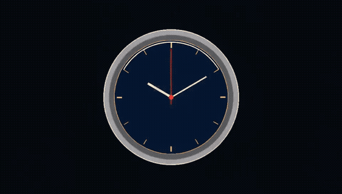
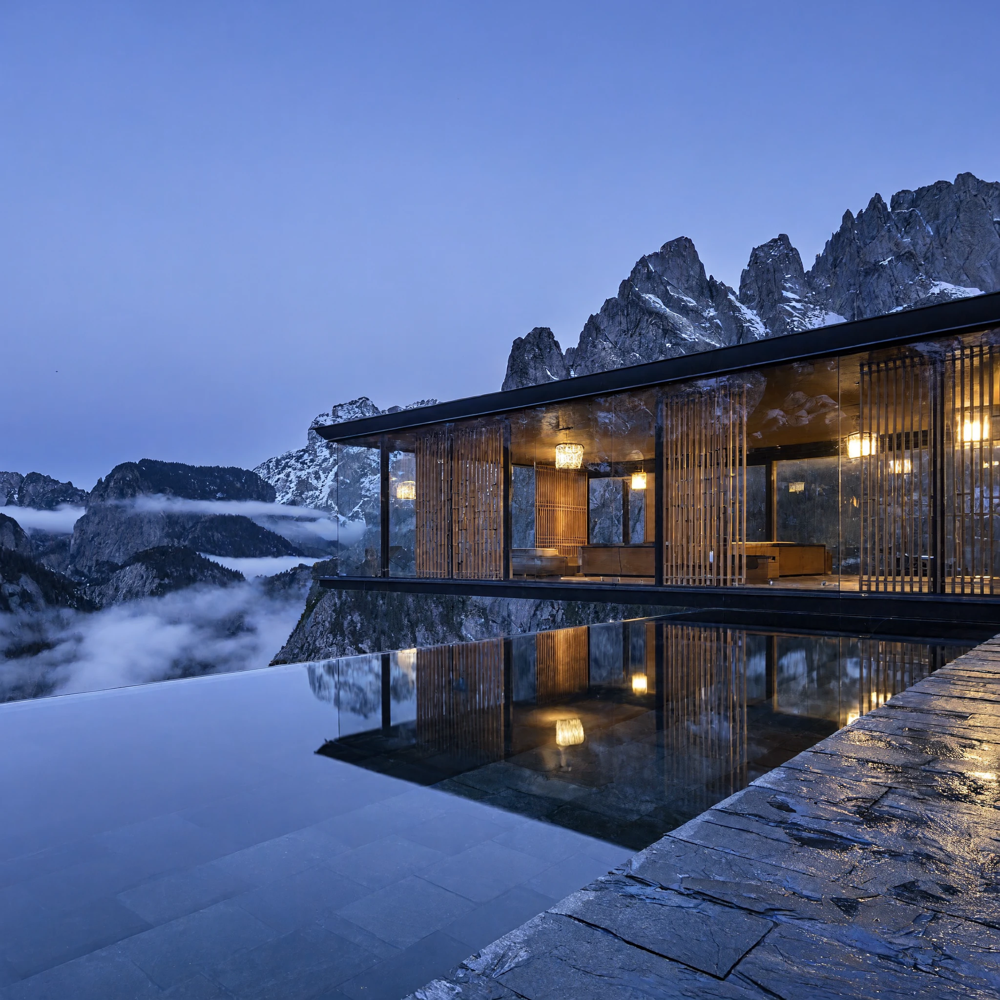

<div align="center">

# MiniMax H3 Colab 工作流合集

**在单张 Google Colab L4（24GB）上用开源量化权重跑通 MiniMax H3（有声视频）与 MiniMax-H3-Image（文生图 / 指令修图）——全程不调用商业 API。**

[English](README.md) | [中文](README_ZH.md)

[](https://colab.research.google.com/github/kuhung/minimax-h3-colab-workflow/blob/main/notebooks/v2.0_minimax_h3_l4_production_mp4.ipynb)
[](LICENSE)
[](#一键启动)

</div>

<p align="center">
  
</p>
<p align="center">
  
  
</p>

<p align="center">
  <sub>上图：<code>v5_0</code> L4 实测三镜头成片（960×544、24fps，原生 32kHz 立体声见已运行 Notebook）。下图：<code>v4_0</code> 2048×2048 文生图（157.8s）与指令修图（226.1s）实测。</sub>
</p>

---

### 核心实测一览（Colab L4 24GB）

| 指标 | 有声视频（`v2.0` 8 步 Turbo） | 图像生成 / 修图（`v4.0` 6 步 PDD） |
|---|---|---|
| **显卡门槛** | NVIDIA L4 24GB（要求 CUDA CC ≥ 8.0，已自动拦截 T4） | NVIDIA L4 24GB（`stable-diffusion.cpp`） |
| **输出规格** | `960×544`、124 帧、24fps `.mp4` + 32kHz 立体声 | `2048×2048` `.png`（文生图 & `<Picture 1>` 指令修图） |
| **稳态耗时** | **165.4 秒 / 镜**（较 CFG=3.0 双路提速 47.6%） | **157.8 秒**（文生图）· **226.1 秒**（指令修图） |
| **估算算力** | **约 0.089 CU / 稳态镜** *（按 1.94 CU/h 估算）* | **约 0.085–0.122 CU / 张** *（不含安装与空闲）* |

---

## 一键启动

点击徽章打开 Colab 后，选择 **代码执行程序 → 更改运行时类型 → L4 GPU**，按顺序执行单元格即可。

| 场景 | 说明 | 直接运行 | 已运行实测 |
|---|---|---|---|
| **文生有声视频（`v2.0`）** | 单路 `CFG=1.0` 8 步 Turbo，直接输出带立体声 MP4 | [](https://colab.research.google.com/github/kuhung/minimax-h3-colab-workflow/blob/main/notebooks/v2.0_minimax_h3_l4_production_mp4.ipynb) | [查看日志与成片](notebooks/v2_0_minimax_h3_l4_production_mp4.ipynb) |
| **图生视频（`v3.1` I2V）** | 用首帧锁定商品或主体外观 | [](https://colab.research.google.com/github/kuhung/minimax-h3-colab-workflow/blob/main/notebooks/v3.1_minimax_h3_i2v.ipynb) | [查看日志与成片](notebooks/v3_1_minimax_h3_i2v.ipynb) |
| **首尾帧转场（`v3.2` FLF2V）** | 同时约束转场起点与终点画面 | [](https://colab.research.google.com/github/kuhung/minimax-h3-colab-workflow/blob/main/notebooks/v3.2_minimax_h3_flf2v.ipynb) | [查看日志与成片](notebooks/v3_2_minimax_h3_flf2v.ipynb) |
| **多模态参考（`v3.3` Ref2VA）** | 组合图像、视频与音频参考驱动生成 | [](https://colab.research.google.com/github/kuhung/minimax-h3-colab-workflow/blob/main/notebooks/v3.3_minimax_h3_ref2va.ipynb) | [查看日志与成片](notebooks/v3_3_minimax_h3_ref2va.ipynb) |
| **文生图与指令修图（`v4.0`）** | `sd-cli` 直出 2048×2048 图像与指令编辑 | [](https://colab.research.google.com/github/kuhung/minimax-h3-colab-workflow/blob/main/notebooks/v4.0_minimax_h3_image_colab_demo.ipynb) | [查看日志与出图](notebooks/v4_0_minimax_h3_image_colab_demo.ipynb) |
| **三镜头尾帧接续（`v5.0`）** | 腕表三镜头连续叙事 + 镜头间原生音轨淡入淡出 | [](https://colab.research.google.com/github/kuhung/minimax-h3-colab-workflow/blob/main/notebooks/v5.0_minimax_h3_watch_storyboard.ipynb) | [查看日志与成片](notebooks/v5_0_minimax_h3_watch_storyboard.ipynb) |

> **自动防忘关机**：`v2.0` 默认开启 `AUTO_SHUTDOWN = True`，导出到 Google Drive 后自动释放实例；`v4.0` 默认 `False` 方便看图，用完请手动断开运行时。

---

## 核心工程优化

- **单路无 CFG 采样（`BasicGuider`, `CFG=1.0`）**：针对蒸馏版 Pruned + Turbo LoRA 取消双路前向，544p 单镜耗时从 `315.8s` 降至 `165.4s`（-47.6%），并同步解码 32kHz 立体声。
- **按 CUDA 版本自动匹配量化权重**：CUDA ≥ 13.0 自动选用 `int8_convrot`；CUDA 12.x 自动切换 `fp8_scaled` + `video_vae_fp16`，吃满 L4 原生 FP8 加速。
- **开跑前自动防坑**：`check_gpu.py` 在扣费前拦截不支持的 T4；`batch_runner.py` 预检 ComfyUI `/object_info` 自动裁剪不兼容字段，并将帧数自动对齐到 `17k + 5`。
- **支持 Colab MCP 与 Agent 批处理**：内置 Drive 权重缓存与自动关机兜底。

---

## 命令行与 Agent 批量执行

在 Colab 实例内可直接一键跑完多镜头批处理（接入说明见 [docs/COLAB_MCP_INTEGRATION.md](docs/COLAB_MCP_INTEGRATION.md)）：

```bash
python scripts/agent_colab_runner.py \
    --workflow workflows/h3_t2v_pdd8_production.json \
    --prompts configs/story_cyber_dawn.json \
    --output /content/drive/MyDrive/MiniMax_Outputs \
    --auto-shutdown
```

无 GPU 本地预检图像多后端命令（支持 `sdcpp` / `comfyui` / `diffusers`）：

```bash
python3 scripts/demo_h3_image.py --backend sdcpp --dry-run
```

---

<details>
<summary><strong>完整 L4 实测基准表、显存余量与计费口径（核对日期 2026-11-12）</strong></summary>

| 工作流 | 配置 | 实测耗时 | 估算 CU *（按 1.94 CU/h）* |
|---|---|---|---|
| `v2_0` 文生视频 | 960×544、124 帧、24fps、8 步、BasicGuider | 首镜 243.5s；稳态 165.3 / 165.5s（均值 **165.4s**）；3 镜 574.6s | 约 0.089 CU/稳态镜（3 镜合计约 0.309–0.310 CU） |
| `v1_0` 显存对照 | 960×544、CFG=3.0；L4 22.03 GB | 393.8s；去噪显存 21.77 GB、峰值 21.91 GB（余量 0.12 GB） | 1344×768 耗时 874.1–875.4s（接近 900s 超时） |
| `v3_1` I2V | 960×544、124 帧、24fps、8 步 | 首镜 258.1s *（含加载）* | 约 0.139 CU |
| `v3_2` FLF2V | 960×544、124 帧、24fps、8 步 | 首镜 273.2s *（含加载）* | 约 0.147 CU |
| `v3_3` Ref2VA | 960×544、124 帧、24fps、4 步 | 首镜 369.2s *（含加载）* | 约 0.199 CU |
| `v4_0` 图像 | `sd-cli`、2048×2048、6 步 PDD、CFG=1.0 | 文生图 157.8s；`<Picture 1>` 修图 226.1s | 约 0.085 / 0.122 CU |
| `v5_0` 腕表三镜 | 尾帧接续 3 镜头（成片 373 帧 / 15.54s） | 265.4 / 183.5 / 195.2s（合计约 644.1s） | 约 0.347 CU |

- 估算 CU 不含环境安装、权重下载与空闲时长，实际扣费以 Google Colab 实时面板为准。
- 脚本已支持 `--turbo-steps 4`，但尚未在 L4 完成同条件 4 步 vs 8 步成对实测。
- 完整出处记录见 [docs/minimax-h3-facts-2026-11-12.md](docs/minimax-h3-facts-2026-11-12.md)。

</details>

<details>
<summary><strong>仓库目录索引与 ComfyUI 15 节点拓扑</strong></summary>

```text
[1] UNETLoader (minimax_h3_fl2va_pruned_fp8_scaled / int8_convrot)
 └──> [10] LoraLoaderModelOnly (minimax_h3_fl2v_turbo_8step / 4step)
       ├──> [7] BasicGuider (CFG=1.0) <── conditioning ── [6] MiniMaxH3ImageToVideo <── [2] CLIPLoader (Qwen3-VL 32B NVFP4)
       │         ▼                                                                       └── [4] VAELoader (Video VAE)
       │    [3] SamplerCustomAdvanced (RandomNoise + res_multistep + simple 8-step)
       ├──> [8] VAEDecode (Video) ──────┐
       └──> [12] VAEDecodeAudio (32kHz) ┴──> [13] CreateVideo (24fps) ──> [9] SaveVideo (.mp4)
```

- **Notebooks**：[notebooks/README.md](notebooks/README.md)（空白模板 + 含实测输出示例）
- **核心脚本**：[agent_colab_runner.py](scripts/agent_colab_runner.py)、[batch_runner.py](scripts/batch_runner.py)、[check_gpu.py](scripts/check_gpu.py)、[download_models.py](scripts/download_models.py)、[demo_h3_image.py](scripts/demo_h3_image.py)
- **工作流与配置**：[workflows/](workflows/)、[configs/prompts.example.json](configs/prompts.example.json)、[configs/templates/](configs/templates/)
- **配套深度文章**：[篇一：技术定位与选型对比](docs/articles/01-introduction-and-principles.md) · [篇二：基准工作流与关键参数](docs/articles/02-timeline-prompting.md) · [篇三：MiniMax-H3-Image 与 sd.cpp 直出](docs/articles/03-minimax-h3-image-deepdive-and-colab.md)
- **其他文档**：[RESEARCH_SUMMARY.md](docs/RESEARCH_SUMMARY.md) · [PROMPT_RECIPES.md](docs/PROMPT_RECIPES.md) · [REFERENCES.md](docs/REFERENCES.md) · [ROADMAP.md](docs/ROADMAP.md)

</details>

---

## 参与、延伸工具与许可证

- 遇到报错或有其他显卡实测数据，欢迎提 [问题反馈](https://github.com/kuhung/minimax-h3-colab-workflow/issues/new?template=bug_report.yml) 或 [显卡实测报告](https://github.com/kuhung/minimax-h3-colab-workflow/issues/new?template=benchmark_report.yml)。
- 想对比自建算力与 700+ 主流模型商业 API 的实时价格与性能？可查看 [TrakToken](https://www.traktoken.com)。
- 本仓库代码采用 [MIT License](LICENSE)；MiniMax 模型权重及其他第三方组件保留各自许可条款，详见 [MiniMax H3 Community License](https://huggingface.co/MiniMaxAI/MiniMax-H3/blob/main/LICENSE)。
