# Google Colab MCP 深度集成与 Agent 自动化托管方案

> 本文针对项目 [minimax-h3-colab-workflow](file:///Users/kuhung/roy/3_Active_Labs/minimax-h3-colab-workflow) 引入官方 [googlecolab/colab-mcp](https://github.com/googlecolab/colab-mcp) 进行系统性评估、架构设计与落地实施，旨在将高摩擦的“人工保姆式点选监控”彻底重构为“Agent 全流程自主调度”。

---

## 一、 为什么引入 Colab MCP？（核心价值与痛点破局）

### 1. 原有手动工作流的痛点
在传统的 Colab 运行模式下，用户需要扮演“人肉运维”：
- **操作繁琐琐碎**：需要逐个点击 7 个以上的代码单元格（挂载、检卡、下载模型、起服务、配参数、排队渲染）。
- **监控成本高昂**：MiniMax H3 渲染单镜头需要 3~5 分钟，批量任务（4~8 个镜头）需等待 20~40 分钟，用户必须持续关注页面是否断连。
- **200 算力单元耗尽风险（致命硬伤）**：任务跑完后，如果用户离开电脑或遗忘点击“断开连接并删除运行时”，Colab 实例会持续空转，导致宝贵的 200 计算单元白白扣光。

### 2. 引入 Colab MCP 后的变革
引入 `colab-mcp` 后，交互界面由“浏览器网页”跃迁为“与 Agent 对话”：
- **极简人机交互**：用户只需对 Agent 说：*“帮我用 L4 跑完 `configs/prompts.json` 里的 5 个分镜，完成后自动关机。”*
- **全流程托管**：Agent 自动建立连接、检验 GPU 门禁、拉取或软链接模型、启动 ComfyUI、分派任务并轮询日志。
- **算力绝对安全（自动断开）**：Agent 在核验所有产物落盘至 Google Drive 后，自动执行 `runtime.unassign()` 彻底销毁云端实例，杜绝闲置扣费。

---

## 二、 架构对比与工作流全景

### 1. 传统人工工作流 vs Agent 托管工作流

```mermaid
flowchart TD
    subgraph Manual ["传统人工操作链路 (高摩擦、易遗忘)"]
        M1["打开 Colab 网页"] --> M2["手动确认 L4 运行时"]
        M2 --> M3["点击挂载 Drive"]
        M3 --> M4["手动运行硬件门禁检测"]
        M4 --> M5["手动跑模型下载/软链接"]
        M5 --> M6["启动 ComfyUI 穿透"]
        M6 --> M7["手动编辑/黏贴 Prompt JSON"]
        M7 --> M8["守候 30 分钟看去噪日志"]
        M8 --> M9["手动复制视频链接"]
        M9 --> M10["⚠️ 极易遗漏：手动断开运行时"]
    end

    subgraph AgentDriven ["Colab MCP + Agent 自动化链路 (零摩擦、保额度)"]
        A1["用户输入需求 / 镜头排期"] --> A2["Agent 调用 open_colab_browser_connection"]
        A2 --> A3["浏览器安全桥接并动态注入 MCP 工具"]
        A3 --> A4["Agent 自动化执行 agent_colab_runner.py"]
        A4 --> A5["自动化硬件门禁 (T4 立即阻断 / L4 继续)"]
        A5 --> A6["自动秒级软链接 Drive 模型缓存"]
        A6 --> A7["后台守护 ComfyUI 并无头渲染出片"]
        A7 --> A8["产物与 render_history.jsonl 自动同步 Drive"]
        A8 --> A9["🛑 Agent 触发 runtime.unassign 自动销毁实例"]
    end
```



### 2. `colab-mcp` 底层通讯机制
`googlecolab/colab-mcp` 采用了极其精巧的 **WebSocket 浏览器桥接协议**：
1. 本地启动 MCP Server（基于 `FastMCP`），监听随机端口。
2. 初始暴露 `open_colab_browser_connection` 工具。
3. 调用时调用本地浏览器打开：  
   `https://colab.research.google.com/notebooks/empty.ipynb#mcpProxyToken={token}&mcpProxyPort={port}`
4. Google Colab 网页前端（Chrome 内核）内置 MCP 客户端支持，自动握手连接回 `ws://localhost:{port}`。
5. 连接建立后，Colab 前端通过 `notifications/tools/list_changed` 向 Agent 动态下发工具集（`add_cell`, `execute_cell`, `read_output` 等）。
6. **鉴权安全性**：无需导出 Google Service Account Key 或配置复杂的 OAuth，直接无缝继承用户当前 Chrome 登录态（Google Drive 权限与 Google AI Pro 算力单元）。

---

## 三、 本地配置与环境准备

### 1. 客户端 MCP 配置
在 Antigravity / Gemini CLI 配置文件中增加 `colab-mcp`：

文件路径：`~/.gemini/config/mcp_config.json`（已自动为您配置就绪）

```json
{
  "mcpServers": {
    "colab-mcp": {
      "command": "uvx",
      "args": [
        "git+https://github.com/googlecolab/colab-mcp"
      ],
      "timeout": 60000
    }
  }
}
```

> **提示**：若在 Claude Code 或 Cursor 中使用，配置结构完全一致，均使用 `uvx git+https://github.com/googlecolab/colab-mcp`。

### 2. 本地依赖前置检验
在终端执行测试验证：
```bash
uvx git+https://github.com/googlecolab/colab-mcp --help
```
若正常打印 `usage: colab-mcp [-h] [-l LOG] [-p]`，说明环境完全通过。

---

## 四、 项目内专属交付：`agent_colab_runner.py`

为了避免 Agent 在 Colab 内反复发送琐碎的单步指令而遭遇通信超时，本项目提供了一体化代跑脚本 [scripts/agent_colab_runner.py](file:///Users/kuhung/roy/3_Active_Labs/minimax-h3-colab-workflow/scripts/agent_colab_runner.py)。

### 脚本设计特性：
1. **统一门禁检测**：集成了 `check_gpu.py`，遇到 T4（算力 7.5）自动阻断退出并销毁实例，绝不空转扣费。
2. **完整性缓存挂载**：集成了 `download_models.py`，校验文件体积门限（≥ 90% 实际体积），原子同步，杜绝损坏缓存软链接。
3. **后台守护进程管理**：自动以无头守护模式拉起 ComfyUI，健康检查通过后即刻提交渲染。
4. **批量无头出片**：调用 `batch_runner.py` 依次渲染镜头，精准解析输出节点，并将视频/动图与元数据实时同步至 Drive。
5. **三重防扣费守护**：
   - **底线一**：脚本内 `try...finally` 保证无论是正常完成还是异常崩溃均触发 `runtime.unassign()`。
   - **底线二**：后台守护线程 Watchdog 超时硬杀 (`--watchdog-hours`)，杜绝进程死锁。
   - **底线三**：Agent 端在轮询成片完成后主动销毁。

### 命令行运行示例：
```bash
python scripts/agent_colab_runner.py \
    --workflow workflows/h3_t2v_pdd8_production.json \
    --prompts configs/prompts.example.json \
    --output /content/drive/MyDrive/MiniMax_Outputs \
    --auto-shutdown \
    --watchdog-hours 2.0
```

---

## 五、 实战避坑与工程边界（必读）

| 潜在风险 / 场景 | 机制与原因 | Agent 处理规范与最佳实践 |
|---|---|---|
| **1. 浏览器必须保持存活** | `colab-mcp` 依赖 Chrome 标签页作为 WebSocket 节点，不能脱离浏览器运行。 | Agent 调起浏览器后，用户保持 Chrome 窗口打开（可最小化或后台运行），不可关闭该 Colab 标签页。首次挂载 Drive 时需在网页端完成权限弹窗确认。 |
| **2. GPU 运行时初始分配** | Colab 默认新建的空白笔记本可能是 CPU 或 T4。 | 用户首次连接时需确认一次：`代码执行程序 -> 更改运行时类型 -> L4 GPU (高内存)`。Agent 脚本会在第一时间检测算力能力，若非 L4/A100 会立即熔断并关机。 |
| **3. 长时间去噪的超时问题** | 渲染一个批量任务需 20~40 分钟，若 MCP 单次调用 `execute_cell` 一直阻塞等待，可能会遭遇客户端网络超时。 | **推荐异步执行**：Agent 发起 `nohup python -u scripts/agent_colab_runner.py ... > /content/runner.log 2>&1 &`，随后定期读取 `tail -n 20 /content/runner.log` 汇报进度。 |
| **4. 200 算力单元防闲置** | 参考费率估算（待首轮 Benchmark 核准）：L4 约 2.8~4.8 CU/h，A100 约 6.5~11.8 CU/h，具体请以 Colab 右上角「资源」面板实时显示费率为准。 | 坚决开启 `--auto-shutdown` 与 `--watchdog-hours` 参数，双保险依赖 `runtime.unassign()` 保证出片完毕或超时即关机。 |

---

## 六、 典型对话剧本示例

**用户**：
> “把 `configs/prompts.example.json` 里的咖啡和机房这两个镜头渲染出来，要 768p 8步，跑完自动关机。”

**Agent 执行动作**：
1. 校验本地 `configs/prompts.example.json` 配置格式。
2. 调用 `open_colab_browser_connection` 打开并连通 Colab 实例。
3. 注入执行单行命令：
   ```python
   !git clone https://github.com/your-username/minimax-h3-colab-workflow.git /content/repo 2>/dev/null || (cd /content/repo && git pull)
   %cd /content/repo
   !python scripts/agent_colab_runner.py --prompts configs/prompts.example.json --auto-shutdown
   ```
4. 监控进度并在成片逐条生成时向用户汇报：“[1/2] 咖啡微距镜头已完成，耗时 184s，已存入 Google Drive...”。
5. 两个镜头渲染完成，确认 `runtime.unassign()` 已触发，向用户汇报最终成果与单元节约情况。
