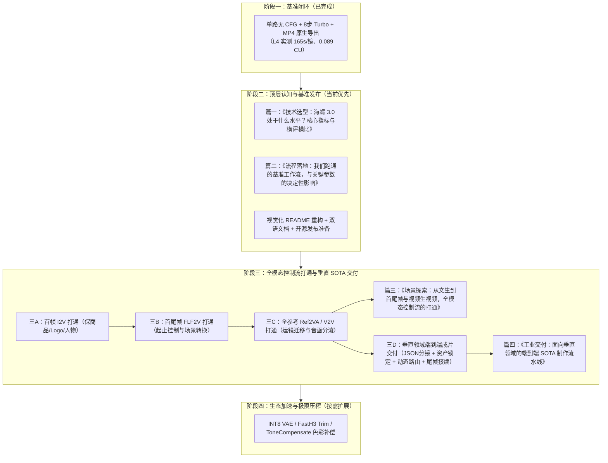

# MiniMax H3 Colab 路线图：从基准闭环到垂直领域 SOTA 交付

核心原则：**以高屋建瓴的 SOTA 制作标准为引领，研发节奏与文档认知深度咬合。先立足实测跑通基准，再系统性打通全场景控制流，最终交付垂直领域的端到端工业化流水线。**

---

## 研发与文档交付全局图谱

---

## 阶段一：跑通最小可用基准闭环（已完成）

现有能力已完成生产实测核准与存证，作为后续全场景开发的坚实底座：
- 单路无 CFG（`BasicGuider`, CFG=1.0）架构落地，单镜推理 8 步，消除过曝与相位失真。
- L4 硬件基准实测核准：稳态耗时 165 秒/镜，单镜算力消耗 0.089 CU（1.94 CU/h 面板费率）。
- ComfyUI 原生节点打包 32kHz 立体声 MP4，零第三方插件依赖。
- 硬件门禁（防 T4 误扣费熔断）与看门狗自动关机保护已全量就位。

---

## 当前执行口径与基准规范

更新日期：2026-11-07。依据见 [SOTA 方案](SOTA_PLAN_20261107.md)。
- **算力口径统一**：仓库统一使用 L4 真实记录 **1.94 CU/h、约 0.089 CU/稳态镜**（960×544、124 帧 @ 24fps、Turbo 8 步、BasicGuider）。历史 0.087 CU 统一标注为历史口径。
- **批次均摊口径**：三镜连续批次历史记录 574.6 秒、0.309 CU，批次均摊约 0.103 CU/镜（含首镜冷启开销），不能替代单镜稳态口径。
- **纯本地路线铁律**：全程纯本地推理，不调用 MiniMax 商业 API，不引入外部计费密钥。商业 API 的闭源编排（Context-IR）与 2K 超分（Regenerate-2K）不在本地运行时内，只借鉴其工程逻辑。

---

## 阶段二：顶层认知与基准发布（当前优先）

本阶段的核心任务是**完成高屋建瓴的技术输出与开源项目包装**，让社区建立对海螺 3.0 的全局技术认知，并深刻理解关键参数对结果的影响。

- [ ] **撰写并交付篇一：《技术选型：海螺 3.0 处于什么水平？核心指标与横评横比》**
  - 从时序一致性、输入上限、音画同频、物理模拟、推理成本五大维度确立评价标准；
  - 客观对标 C 档主力（如 Seedance 2.0 / 2.5），指出开源 H3-Base 距离顶尖闭源模型在长时序叙事与大动态上的代差；
  - 确立海螺 3.0 的核心站位：12 个多模态参考上限（Ref2VA）、原生 32kHz 双声道立体声同出、33B 单流 DiT 开放权重。
- [ ] **撰写并交付篇二：《流程落地：我们跑通的基准工作流，与关键参数的决定性影响》**
  - 不做琐碎配置流水账，高屋建瓴剖析核心工程决策与参数对视频最终结果的决定性影响；
  - 讲透 BasicGuider（CFG=1.0）相比双路 CFG(3.0) 减少 74% 算力且纯化色彩的因果逻辑；
  - 讲透 960×544（对比 768p 避免像素翻倍与自注意力爆炸，锁死 21.77 GB 显存）的黄金平衡；
  - 讲透 8 步 Turbo 对消除动态涂抹（Motion Smear）的平衡；
  - 结合上海街景实测三镜头（生煎早市、梧桐落叶、雨夜外滩），展示扎实成片效果。
- [ ] **视觉化 README 重构与双语支持**：
  - 交付成片演示动图、有效 Open in Colab 徽章、实测成本账目表、双语文档（`README.md` 与 `README_CN.md`）；
  - 统一全仓库能力声明与数据口径。
- [ ] **核心渠道发布准备与 Issues 规范**：
  - 整理 V2EX、X、即刻、Reddit 的技术分享文案；
  - 建立标准 `.github/ISSUE_TEMPLATE/` 收集环境、节点契约与复现日志。

---

## 阶段三：全模态控制流打通与垂直 SOTA 交付

本阶段开发与文章计划深度咬合，贯彻**“一个脚本只做一个实验目的”**与**“即插即用可替换模板”**原则，分层推进单模态控制流打通与工业级连贯流水线：

### 交付包 A：V3 系列原子化控制流与可替换模板库（支撑篇三）
- [ ] **交付 3 个解耦的单目的线上 Colab 脚本**：
  - `notebooks/v3.1_minimax_h3_i2v.ipynb`（首帧图生视频：专注商品外观与人物 Logo 锁定）；
  - `notebooks/v3.2_minimax_h3_flf2v.ipynb`（首尾帧控制：专注起止边界约束与防渐变融化 Bug）；
  - `notebooks/v3.3_minimax_h3_ref2va.ipynb`（全模态参考：专注运镜轨迹迁移与双音轨分流）。
- [ ] **交付即插即用的可替换场景配置库（`configs/templates/`）**：
  - 机械腕表商业广告模板（`i2v_watch_anchor.json`）；
  - 空间形态演变转场模板（`flf2v_morph_transition.json`）；
  - 动作与运镜复刻模板（`ref2va_motion_transfer.json`）；
  - 并在各 Notebook 提供“替换素材与提示词（Swap & Run）”独立代码单元格，读者一键换参即跑。
- [ ] **跑通独立工作流拓扑与输入门禁**：
  - 落地 `workflows/h3_i2v_production.json`、`workflows/h3_flf2v_production.json`、`workflows/h3_ref2va_production.json`；
  - 落地输入门禁 `scripts/validate_inputs.py`（尺寸对齐、文件配额 ≤12、24fps 统一转码）。
- [ ] **记录完整运行参数与基准测试数据**：实测记录 960×544 规格下各模式的峰值显存（GB）、单镜耗时（秒）与算力开销（CU）；
- [ ] **交付实际生产的样片与效果图**：将各模式实测生成的样片保存在 `outputs/showcase/multimodal/`，作为文章核心配图；
- [ ] **撰写并交付篇三：《场景探索：从文生到首尾帧与视频生视频，全模态控制流的打通》**。

### 交付包 B：V4 工业级多镜头流水线与长程连贯性交付（支撑篇四）
- [ ] **交付线上可运行 Colab 脚本**：`notebooks/v4.0_minimax_h3_vertical_sota_pipeline.ipynb`，运行端到端六步工业流水线；
- [ ] **系统性落实长程连贯性工程机制**：
  - **角色一致性三级保障机制**：固定特征提示词块 -> 分镜静态定妆照资产 -> 动态生成期 Ref2VA 绑定；
  - **长镜头无损衔接与防跳变**：前一镜尾帧自动截取并传递为下一镜首帧，遵循动量守恒；
  - **镜头色彩一致性防暗机制**：引入 `ToneCompensate`（`frame_shift` 模式）亮度补偿，防范连续生成逐渐发暗，锁定 BT.709 色彩空间；
  - **三层声音分轨与最终合流**：对白、环境音、BGM 独立分轨与多镜头最终合流。
- [ ] **跑通工业级六步生产流水线**：
  - ① 剧本结构化为 JSON 分镜（2–5 秒黄金时长，字幕 ≤15 汉字，`configs/vertical_drama_sample.json`）；
  - ② 静态资产与分镜关键帧锁定；
  - ③ 动态路由调度（空镜走 T2V、商品走 I2V、转场走 FLF2V、剧情走 Ref2VA）；
  - ④ 尾帧无损导出作为下一镜首帧接续；
  - ⑤ & ⑥ 三层声音分轨（对白、环境音、BGM）与最终成片合流。
- [ ] **记录流水线性能与成本核算数据**：记录 3–5 镜头连续调度的总耗时、峰值显存平稳度与总 CU 成本；
- [ ] **交付实际生产的多镜头成片与效果图**：将完整 3–5 镜头商业广告/短剧成片（MP4，带字幕音效）与分镜定妆照、接续帧对比图保存在 `outputs/showcase/vertical_sota/`，作为文章核心证据；
- [ ] **撰写并交付篇四：《工业交付：面向垂直领域的端到端 SOTA 制作流水线》**。

---

## 阶段四：生态加速与极限压榨（按需扩展）

在全场景功能与垂直流水线跑通后，针对具体性能瓶颈逐项评估引入，不盲目堆叠插件：
- [ ] 评估 INT8 ConvRot VAE（2.81 GB，编码提速 2.2 倍、解码提速 1.4–2.7 倍）及老架构 fp16 回退；
- [ ] 评估长视频连续生成的色调与亮度补偿（ToneCompensate 保持 BT.709）；
- [ ] 评估 TE-Speed 块缓存与 PowerLoraStack 多 LoRA 挂载；
- [ ] 评估 FastH3 Trim / GGUF 等超轻量化方案。

---

## 执行约定

所有开发均以可复现的脚本、配置、成片与日志为验收准绳。文档输出与研发节奏严格同步：阶段二交付篇一、篇二；阶段三交付篇三、篇四。各阶段不虚构未经实测的成果，始终保持求真务实的技术品格。
