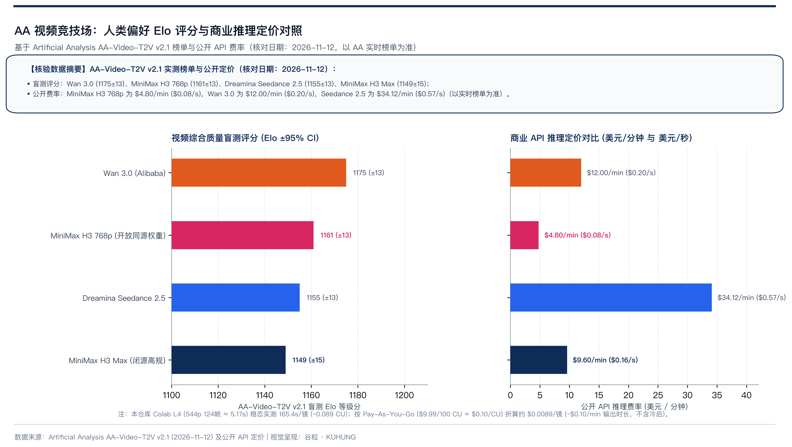

# MiniMax H3（海螺 3.0），开源视频生成模型，技术定位与选型对比

> MiniMax H3（海螺 3.0）开放 33B 单流 DiT 基础权重（约 768p）后，普通人落地关心两件事：多大的卡能跑，以及它与 Wan 3.0、Seedance 2.5、可灵 3.0 的能力差异。
>
> 本文是「MiniMax H3（海螺 3.0）实战」系列的第一篇，基于 2026-11-12 调查数据与 Google Colab L4 实测基准，从五个维度分析 MiniMax H3 的实力水平。

MiniMax H3（海螺 3.0）是 MiniMax 于 2026 年夏季发布的多模态音画生成模型。官方开放了 33B 参数的单流 Diffusion Transformer 主干权重 `H3-Base`（约 768p）[^3]，支持最多 12 个多模态参考文件与原生 32kHz 双声道立体声同出；经 AdaLN 剪枝和 NVFP4/INT8 量化后，可在单张 24 GB 显存显卡（如 Google Colab L4）上离线推理。按其社区协议，适用地区内商业产品与服务年营收不超过 2000 万美元且在界面显著标注 `MiniMax H3` 即可免版税商用，超过该门槛或位于欧盟、英国、韩国、美国等排除区域需单独联系官方申请授权 [^9]。

## 视频生成的五个评判标准

在学术界与工业生产实践中，评估一个视频生成系统能否真正落地，主要参照 VBench 评测框架 [^7] 与实际数字资产管线的工程要求，通常可提炼为以下五个维度：

### 1. 时序与上下文一致性

镜头往前推进或旋转时，主角的五官不能每隔三帧就换张面孔，衣服上的褶皱和纹理不能在转弯时融化消失。

以实际电商鞋靴 360 度环绕展示镜头为例：镜头从正面缓缓推向侧面，如果鞋舌上的品牌字样在旋转时形变成乱码，或者鞋底的气垫结构在第 60 帧突然解体，那是不行的。在模型参数上，这一项直接取决于单流 Diffusion Transformer（DiT）的时空自注意力机制与 3D 因果 VAE 的时间因果压缩比。

### 2. 多模态参考输入容量

商业制作很少靠纯文字抽卡。大部分工业交付场景需要把特定商品资产、人物定妆照以及动作轨迹一起喂给模型。

以智能手表商业广告为例：制作团队需要同时输入 6 张不同角度的手表实物白底图、1 张代言人手腕定妆图、1 段慢动作运镜参考视频以及 1 段品牌特制音频。单次推理能同时容纳多少多模态参考素材，直接决定了项目能否统一固定外观。在 MiniMax H3 架构中，这项能力由顶层的 `H3-Context-IR` 编码器承接，支持最高 12 个多模态参考文件。

### 3. 原生音画同频能力

传统的影视制作流程是画面跑归画面，音频靠后期找调音师在剪辑软件里逐帧对位贴上去。

以市井早市热油生煎包分镜为例：平底锅热油翻滚，伴随着蒸汽升腾。传统做法需要后期人工对位油煎滋滋声、锅盖刮擦声与环境杂音；原生音画生成则是在潜空间去噪的过程中，同步解算出视频画面与 32kHz 双声道立体声波形。

### 4. 复杂物理模拟与运动幅度

镜头面对大范围肢体动作、重力加速、流体飞溅以及复杂碰撞时，画面能否遵循真实的物理动力学规律，还是只在表面做二维像素扭曲。

以跑酷腾空翻转或武打肢体碰撞为例：模型需要真实还原重心位移、动量守恒与布料跟随惯性，保持四肢连续自然、防止空中粘连或拉丝。在工程参数上，这直接关联到采样算法的步数选择（例如 8 步 Turbo 采样相比 4 步可减少高频动作伪影）。

### 5. 开源生态与推理成本

方案有没有开放基础权重，能不能在常规消费级显卡上量化运行，单镜头的耗时与算力账单是多少，决定了团队能不能把它做成本地化、可批量运行的生产线。

以日产 500 条素材的资产管线为例：若单条视频完全依赖高价商业 API，单日抽卡成本可能快速累积至万元级；若基于开源剪枝权重在单卡 24 GB 显存显卡上推理，按本仓库 Colab L4 历史面板基线（稳态约 `$0.10/min` 视频产出）算，比同规格官方 API（`$4.80/min`）低约 48 倍，比高价闭源 API（`$34.12/min`）低出上百倍。当然，降分辨率与量化后质量会有折损。

## MiniMax H3 架构与 24GB 剪枝

MiniMax 于 2026 年夏季推出海螺 3.0，并开放了 33B 参数的单流 Transformer 基础模型 H3-Base 权重 [^3]。完整的 MiniMax H3 系统在架构上分为三层：

顶部是云端托管的 H3-Context-IR，负责解析多模态输入并序列化为结构化上下文中间表示；中部是核心生成主干 H3-Base，负责生成 768p 分辨率的视频与音频潜变量；底部是闭源的 H3-Regenerate-2K，用于将 768p 结果超分重构为 2K 最终交付成片。

开放权重的是中部的 H3-Base。

在底层特征提取上，H3-Base 采用 Qwen3-VL-32B 提取隐藏状态，配合自定义 Token 捕捉时空关联。自编码器设计上，视觉端采用时间因果 VAE，配合 Patchify 实现等效 32 倍空间与 4 倍时间的压缩；音频端独立处理双声道，将 32kHz 音频压缩为潜 Token。

工程部署上还有一个细节：权重剪枝。H3-Omni-Transformer 虽然标注为 33B 参数，其中约 13B 参数位于 AdaLN 分支。纯推理阶段这部分参数可以预先计算为查找表直接固化，不需要常驻显存。开源社区推出的剪枝版权重体积直接缩减了 40% [^4]，使得原本全精度约 131 GB+ 的整套权重压缩到约 42.5 GB（主干约 19.5 GB），再配合量化在 24 GB 显存的卡上也能跑起来 [^6]。

## 对比 Seedance 2.5 与可灵的边界

判断 MiniMax H3 处于什么位置，我们拿它和字节跳动即梦的 Seedance 2.5、快手可灵 3.0 对照。

它的短板主要在两件事：

第一是长镜头编排。Seedance 2.5 内置了叙事规划器（Narrative Planner）和双分支扩散结构 [^1]，给一段剧本会自动拆出全景、中景、特写，还支持最多 3 人的音色克隆和 15 秒长片段。单卡跑的 H3-Base 没有这层自动编排，写多镜头故事得自己一镜一镜卡分镜和时间戳。

第二是大动作物理模拟。遇到打斗、翻滚这类身体重心大范围移动的镜头，快手可灵 3.0 更稳 [^2]；H3-Base 容易出现局部肢体粘连，它的长处还是平稳运镜和日常环境交互。

它的长板则集中在三点：

第一是最多 12 个多模态参考容量（Ref2VA）[^3]。MiniMax H3 允许单次混合输入最多 9 张参考图、3 段参考视频（总时长 15 秒以内）与 3 段参考音频（总时长 15 秒以内），并通过 `@媒体N` 语法绑定到具体角色、运镜轨迹或声音节奏。这个输入容量在开源模型里处于前列，固定商品外观和人物长相做起来很顺手。

第二是原生 32kHz 立体声音画同出 [^3]。扩散过程直接产出音频潜变量，经由 AudioVAE 解码后就是包含环境声、拟音与基础台词的独立双声道音频，不用再另外找音效库一轨一轨贴。

第三是能装进单张 24 GB 显卡本地跑。配合 NVFP4 或 INT8 量化，个人和小工作室不用长期绑死商业 API，也能自己搭一套可控的本地工作流。

## AA 盲测评分与 L4 推理成本对照

评估视频生成模型好不好用，常见有两类办法：

一类是自动化算法指标，比如算特征分布距离的 FVD、算图文匹配度的 CLIP-Score，或者拆成 16 个客观维度的 VBench 测试套件 [^7]。这类方法靠公式跑分，速度快、好复现，适合盯清晰度、抖动和语义一致性；但镜头好不好看、表情自不自然、物理合不合理，公式算不出来，得靠人眼盲测。

另一类就是大规模标准化样本的人类偏好盲测，代表平台是 Artificial Analysis（AA）[^5]。

AA 的视频竞技场主要靠三个机制运转：

第一是标准化题目与分轨对决。AA 维护了一套覆盖人像特写、快速运镜、流体与街景光影的测试提示词，而且文生视频只和文生视频比，图生视频只和图生视频比，带原生声音的模型和静音模型严格分开，不跨赛道混评。

第二是双盲二选一（Pairwise Blind Voting）。评审者并排看同一个提示词下两个匿名模型生成的视频，左右位置随机打乱，看完必须按提示词还原度、动作真实感和连贯性二选一。

第三是背后的概率计分模型。AA 汇总大量盲测结果，用 Bradley-Terry 模型做全局最大似然估计（MLE）：

$$P(A \succ B) = \frac{1}{1 + 10^{(R_B - R_A)/400}}$$

其中 $R_A$ 和 $R_B$ 是两个模型的实力分（Elo 评分）。赢过强手加分多，赢过弱手加分少。平台还会用 Bootstrap 重采样算出 95% 置信区间，防止少数样本把分数拉偏。

除了综合画质分（Overall Quality Elo），AA 榜单还会细分视频编辑分（Video Editing Elo）、带原生音频的文生视频分（T2V with Audio Elo）以及每分钟商业调用成本。

结合 AA 视频竞技场官方实测数据 [^5]，几款代表模型的盲测分数与商业定价对照如下：

基于 Artificial Analysis **AA-Video-T2V v2.1** 榜单、公开 API 费率与本仓库 Colab L4 实测基准，主要对比结果如下：

| 模型 | AA-Video-T2V v2.1 Elo (95% CI) | 商业 API 定价 | 本地 / 自建算力参考 |
|---|---|---|---|
| **Wan 3.0** | `1175 (±13)` | `$12.00/min`（`$0.20/s`） | 闭源商业调用 |
| **MiniMax H3（海螺 3.0，768p 开放同源规格）** | `1161 (±13)` | `$4.80/min`（`$0.08/s`） | Colab L4 544p 稳态 `165.4s` / `~0.089 CU/镜`（约 `$0.0089/镜`，视频约 `$0.10/min`，不含冷启与返工） |
| **Dreamina Seedance 2.5** | `1155 (±13)` | `$34.12/min`（`$0.57/s`） | 闭源商业调用 |
| **MiniMax H3 Max** | `1149 (±15)` | `$9.60/min`（`$0.16/s`） | 官方托管高规版 |

*(注：I2V 与历史快照榜单中各模型相对位次存在差异，例如 I2V 赛道 Seedance 2.5 约 1161、MiniMax H3 约 1115–1133，选型时建议按具体赛道看对应榜单。)*

### 单卡 Colab L4 自建算力基准

在 Google Colab 单卡 L4 上，本仓库历史资源面板记录费率为 **`1.94 CU/h`** [^6]。跑 544p 量化工作流生成 124 帧（24fps，约 `5.17s`）有声视频时，稳态单镜耗时 `165.4 秒`，耗损约 **`0.089 CU`**（三镜批次含冷启动均摊约 `0.103 CU/镜`）。按 Colab Pay-As-You-Go 标价 **`$9.99 / 100 CU`**（约 `$0.10/CU`）折算，单镜稳态算力消耗约 **`$0.0089`**（视频产出折合约 **`$0.10/min`**，不含冷启动、下载、失败返工）。

## 主流视频模型选型

结合公开文档与 AA 榜单快照，几家主流视频模型的定位和适用场景整理如下：

| 模型 / 套件 | 架构定位与开放形态 | 音频能力与 AA-Video-T2V v2.1 评分 | 公开费率 / 本地门槛 | 典型适用场景 |
|---|---|---|---|---|
| **Wan 3.0 (Alibaba)** [^8] | 商业旗舰 DiT 架构 | 支持原生音频，AA T2V v2.1 `1175 (±13)` | 公开 API `$12.00/min` (`$0.20/s`) | 复杂长镜头、商业主视觉；开源端另见 Wan 系列 FLF/VACE 工具 |
| **MiniMax H3（海螺 3.0，768p）** [^3][^4][^9] | 33B 单流 DiT，开放 ~768p 基础权重（社区协议有营收与地域门槛） | 原生 32kHz 双声道立体声，AA T2V v2.1 `1161 (±13)` | 公开 API `$4.80/min` (`$0.08/s`)；Colab L4 稳态约 `0.089 CU/镜` (`~$0.10/min` 视频) | 商品外观锁定、市井环境声景、24 GB 单卡批量工作流 |
| **Dreamina Seedance 2.5** [^1] | 闭源双分支 DiT 架构 | 音画同步与多角色音色克隆，AA T2V v2.1 `1155 (±13)` | 公开 API `$34.12/min` (`$0.57/s`) | 多镜头叙事短片、需定制人声对白的角色剧集 |
| **MiniMax H3 Max** [^3] | MiniMax 高规格托管版 | 原生立体声景与高规画质，AA T2V v2.1 `1149 (±15)` | 公开 API `$9.60/min` (`$0.16/s`) | 免本地运维的官方托管高规出片 |
| **Kling 3.0 Omni (可灵)** [^2] | 闭源自研 DiT 动力学架构 | 拟真音色对口型 | 按官网分层计费 | 大幅度肢体运动、打斗跳跃等强动力学镜头 |

## 开源自建还是商业 API：选型建议

走本地开源路线：
- 如果主要做电商静物展示、工业品渲染，或者带现场环境音的街景空镜，MiniMax H3 是划算的底座。它的多图参考能锁住商品外观，32kHz 原生声景能直接出环境音和拟音，量化后在单张 24 GB 显卡上就能跑（商用时对照社区协议里的地区与 2000 万美元年营收上限）。
- 如果要做两端画面平滑变形的转场，可以搭一套通义万相开源分支的 FLF2V / VACE 工作流。

走商业 API 路线：
- 遇到大幅度武打动作或翻滚镜头，交给可灵这类强动力学模型处理。
- 要做多镜头剧本拆解和角色音色克隆的短片，可以上 Seedance 2.5，同时算好 `$34.12/min` 带来的抽卡预算。
- 直接追求文生视频盲测上限且预算充裕，可以对标 Wan 3.0（`$12.00/min`）。

搞清 MiniMax H3（海螺 3.0）的技术定位后，你可以直接看本项目的 [工程仓库总览](../../README.md)、[v2.0 Colab L4 生产笔记本模板](../../notebooks/v2.0_minimax_h3_l4_production_mp4.ipynb) 与 [2026-11-12 核验事实台账](../minimax-h3-facts-2026-11-12.md)，或者继续读第二篇，拆解 24 GB 单卡上的基准工作流和关键参数设置。

## MiniMax H3 选型常见问题

### MiniMax H3（海螺 3.0）开源权重能在 24GB 显卡上跑吗？

可以，但需要剪枝与量化权重，并把分辨率和步数控制住。`H3-Base` 原版全套全精度权重约 131 GB+，经社区剪枝剥离约 13B AdaLN 分支并量化后，全套权重压到约 42.5 GB（主干约 19.5 GB），即可在 24 GB 单卡上加载；按本仓库 Colab L4（约 22 GB 可用显存）实测，以 `960×544`、124 帧、8 步 Turbo 与单路 `BasicGuider (CFG=1.0)` 运行，稳态单镜约 165.4 秒。

### 开源版 H3-Base 和官方云端完整版差在哪里？

开源的是中间生成主干 `H3-Base`（约 768p 基础权重），云端托管的 `H3-Context-IR` 多模态自动编排与 `H3-Regenerate-2K` 超分重构模块并没有开源。本地跑离线可控、算力便宜，但长剧情分镜拆解和时间线提示词要自己或靠本地脚本提前写清楚。

### MiniMax H3 开源权重可以商用吗？

在适用地区内，商业产品或服务年营收不超过 2000 万美元、并在界面显著标注 `MiniMax H3` 即可按社区协议免版税商用 [^9]。如果年营收超过 2000 万美元，或者位于欧盟、英国、韩国、美国等排除区域，需要发邮件至 `api@minimax.io` 单独申请书面授权；协议同时禁止将权重直接转售、包装为 API 服务对外提供，或用于训练其他非 H3 衍生模型。

## 「MiniMax H3（海螺 3.0）实战」全系列导航

- 第一篇：MiniMax H3（海螺 3.0），开源视频生成模型，技术定位与选型对比（本文）
- [第二篇：流程落地：我们跑通的基准工作流，与关键参数的决定性影响](02-timeline-prompting.md)
- [第三篇：图像与指令编辑：`MiniMax-H3-Image` 纯开源架构拆解与 Colab `sd.cpp` 实战](03-minimax-h3-image-deepdive-and-colab.md)

## 项目开源仓库

本文对应的 Colab L4 生产模板、ComfyUI 工作流与实测日志均已开源：

- GitHub 仓库：[https://github.com/kuhung/minimax-h3-colab-workflow](https://github.com/kuhung/minimax-h3-colab-workflow)

## 原文对照与参考文献

*(文中外部榜单分数、商业 API 定价与 Colab 资费均核对自 2026-11-12 公开信息，实际以各官网及实时计费面板为准。)*

[^1]: [字节跳动即梦与 Seedance 官方技术文档：双分支 DiT 架构与叙事规划器规范](https://jimeng.jianying.com)
[^2]: [快手可灵 AI 开发者官方技术文档：DiT 运动动力学建模与视频延长规范](https://klingai.kuaishou.com)
[^3]: [MiniMax 官方 GitHub 技术文档：`MiniMax-AI/MiniMax-H3` 33B 单流 DiT 与 12 模态输入规范](https://github.com/MiniMax-AI/MiniMax-H3/blob/main/README.zh-CN.md)
[^4]: [Comfy-Org 官方技术模型卡：`Comfy-Org/MiniMax-H3` 剪枝模型与 13B 参数剥离机理](https://huggingface.co/Comfy-Org/MiniMax-H3)
[^5]: [Artificial Analysis 官方视频模型竞技场（AA-Video-T2V v2.1 核对日期：2026-11-12）](https://artificialanalysis.ai/video)
[^6]: [本仓库事实台账与 L4 实测基准：`docs/minimax-h3-facts-2026-11-12.md` & `docs/RESEARCH_SUMMARY.md`](../minimax-h3-facts-2026-11-12.md)
[^7]: [上海人工智能实验室：VBench 视频生成全方位评测基准框架 (CVPR 2024)](https://vbench.github.io)
[^8]: [阿里巴巴通义实验室：Wan 视频生成模型架构与 ComfyUI FLF 首尾帧教程](https://docs.comfy.org/zh/tutorials/video/wan/wan-flf)
[^9]: [MiniMax H3 官方开源协议：`MiniMax H3 Community License Agreement`](https://huggingface.co/MiniMaxAI/MiniMax-H3/blob/main/LICENSE)
