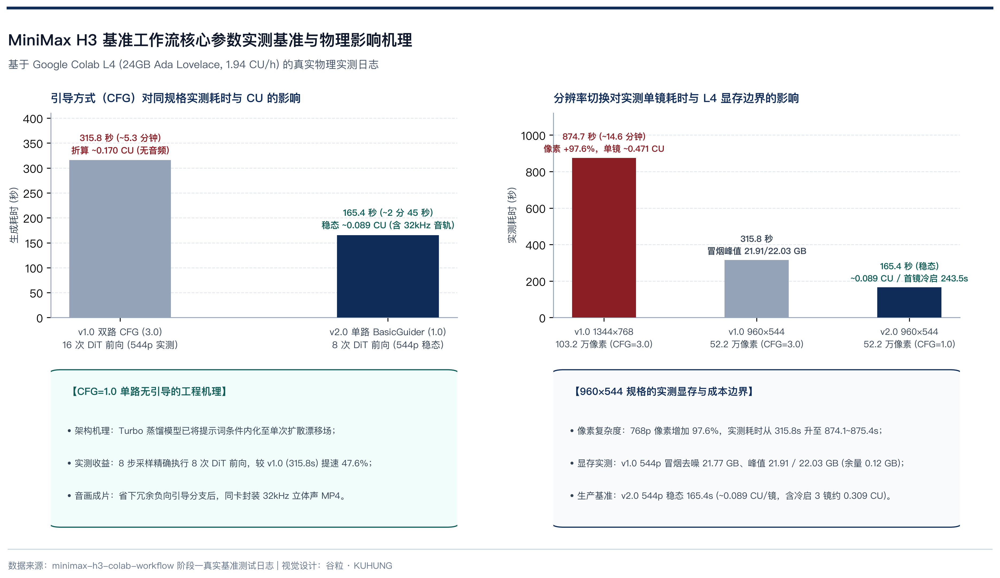

# 流程落地：我们跑通的基准工作流，与关键参数的决定性影响

> 在 24 GB 显卡上跑百亿参数的视频模型，常见的问题有三个：显存溢出崩溃、单镜头渲染十多分钟，以及画面过饱和或音频破音。要让工作流稳定出片，引导方式、分辨率和采样步数这几个参数直接决定了速度和成片质量。
>
> 本文是「MiniMax H3（海螺 3.0）实战」系列的第二篇，基于 Google Colab L4 24 GB 实测日志，拆解单路无 CFG、960×544 分辨率与 8 步 Turbo 采样的取舍，并附上上海街景三镜连续运行数据。

## 基准工作流的架构设计

本项目采用 Google Colab 单张 NVIDIA L4 GPU 作基准环境（Ada Lovelace 架构，24 GB 显存，算力 8.9，本仓库历史面板校准费率 `1.94 CU/小时`）。

为了让 24 GB 显存装得下模型，整套权重做了剪枝与量化组合：主干采用剥离了 13B 冗余分支的 AdaLN 剪枝版（Pruned）扩散模型，文本编码器挂载 `14.6 GB` 的 Qwen3-VL-32B NVFP4 量化版，加上视频、音频双 VAE 与 8 步 Turbo LoRA，整套权重体积控制在 `42.5 GB` 上下。

工作流只用 ComfyUI 官方原生节点串联，按顺序分为四步：

1. 文本经 Qwen3-VL 编码后，通过 `MiniMaxH3ImageToVideo` 构建时空潜变量；
2. 接入 `BasicGuider` 锁定 `CFG=1.0` 单路引导；
3. 采样器由 `SamplerCustomAdvanced` 驱动，搭配 `KSamplerSelect`（`res_multistep`）与 `BasicScheduler`（`simple`）；
4. 潜变量一路解出视频帧，另一路经音频 VAE 解为 32kHz 双声道波形，最后交由 `CreateVideo` 与 `SaveVideo` 封装为 `.mp4`。

全程不依赖第三方扩展插件，避免插件更新带来兼容性报错，后面把工作流迁移到其他机器也更省事。

## 单路无引导对速度与画质的影响

跑通用扩散模型时，大家习惯使用带正负提示词的双路采样，并把无分类器引导尺度（CFG）设在 `3.0` 到 `7.0` 之间。在双路模式下，每走一步去噪都要算一次正向预测和一次负向预测：

$$\epsilon_{\text{pred}} = \epsilon_{\text{uncond}} + \text{CFG} \times (\epsilon_{\text{cond}} - \epsilon_{\text{uncond}})$$

这意味着 32B 文本编码器和 33B DiT 主干在每一步都要执行两遍前向传播。如果跑 8 步采样，DiT 实际要算 16 次。在仓库 `v1.0` 同分辨率（`960×544`）双路 `CFG=3.0` 实测中，单镜头耗时达到 **315.8 秒**（当时还只是无声 WebP）；切到 `1344×768` 时更拉长到 **874.1 至 875.4 秒**。

MiniMax 官方开源的剪枝模型与配套 Turbo LoRA，在训练阶段已经做过无分类器引导蒸馏（CFG-Distilled），把提示词引导内化进了单次扩散漂移场里，不需要再靠无条件预测做反向外推。

因此，`v2.0` 工作流改用 `BasicGuider` 节点，把引导参数锁死在 `1.0` 单路推理。

8 步只跑 8 次前向传播后，同样 `960×544`、124 帧规格，端到端耗时从 `v1.0` 实测的 **315.8 秒** 降到稳态 **165.4 秒**（少用约 **47.6%** 时间），还一并封好了 32kHz 立体声 `.mp4`。

画质和音质也跟着变稳了。如果硬在已蒸馏模型上叠加大于 `1.0` 的外推差值，潜空间数值容易顶到极端区间，造成高饱和偏色、高光边缘发焦、小动作抽搐，以及音频潜变量解码破音。锁回单路 `1.0` 后，色彩表现更接近常规范围，32kHz 环境声也不容易炸音。

## 分辨率与显存占用对比

很多人第一反应会把分辨率拉满，但在 DiT 架构里，像素数增加会带来非线性计算膨胀。我们在 L4 上对比了 `960×544` 与 `1344×768` 两种规格：

`960×544` 单帧约 52.2 万像素，`1344×768` 单帧约 103.2 万像素，像素数量上涨了 `97.6%`。在单流 Transformer 的全注意力计算中，时空 Token 序列拉长会让显存和耗时急剧攀升：

- `v1.0` `CFG=3.0` 下，`1344×768` 单镜耗时跳到 `874.1` 至 `875.4` 秒，在按时间计费的实例上开销过高；
- `v1.0` `960×544` 冒烟测试中，`nvidia-smi` 记录到去噪稳态显存为 **21.77 GB**、峰值达到 **21.91 GB**（该次 L4 总可用显存 **22.03 GB**，只剩 **0.12 GB** 余量）；
- 切到 `v2.0` 单路架构后，`960×544` 在 L4 实例（该次可用显存 `22.49 GB`）上的稳态单镜耗时收敛在 **165.3 到 165.5 秒** 之间。

按 `1.94 CU/小时` 的历史面板基线折算，单个稳态镜头消耗的算力约为：

$$1.94 \times \frac{165.4}{3600} \approx 0.089\ \text{CU}$$

因此生产模板把默认规格定在 `960×544`，尽量在 24 GB 单卡上避开 OOM 风险。

## 采样算法与 Turbo 步数取舍

在极低步数蒸馏模式下，采样器对动态细节影响明显。常规 Euler 采样器在 20 步以上表现平稳，但在 4 到 8 步区间容易出现帧间闪烁和细节发糊。

基准工作流选用 `res_multistep` 采样器搭配 `simple` 调度器，利用多步历史梯度做高阶修正，能更好保住热气、水波和树叶这类细碎运动。

仓库目前同时接入了 4 步和 8 步 Turbo LoRA 参数开关，两者的边界很清楚：

- **4 步开关**：代码与 CLI（`--turbo-steps 4`）已接入，适合前期快速看构图，但细小动态细节更吃历史梯度外推，更容易涂抹发糊。由于仓库暂未在 L4 上做同条件 4 步成对实测，这里不承诺具体提速数字；
- **8 步基线**：仓库已完成完整实测，稳态约 `165.4 秒`（2 分 45 秒上下）即可保留油煎蒸汽、湿石板倒影与树叶微颤的清晰边缘，是当前默认生产参数。

## 上海街景 3 镜实测记录

为验证这套参数在日常场景下的稳定性，我们使用包含市井烟火、白天自然光与夜景反光的上海街景分镜（[configs/shanghai_street.json](../../configs/shanghai_street.json)）跑了连续三镜批处理，单镜均设为 `960×544`、124 帧、24fps（约 5.16 秒）、8 步 Turbo 与单路 `CFG=1.0`。

- **镜头一（石库门生煎早市）**：铁锅热油煎烤生煎包，晨光里有白雾升起。成片保住了热油沸腾与蒸汽散开的连续动作，32kHz 原生音轨同时出了油煎滋滋声、锅盖碰声和远处自行车铃声。
- **镜头二（武康路梧桐）**：镜头慢速前推，金黄色梧桐叶从树冠飘落到沥青路面。8 步采样保留了落叶翻滚轨迹，音轨自带风声和老式电车低沉的运行声。
- **镜头三（外滩雨夜倒影）**：低角度贴地滑行，拍积水里的陆家嘴霓虹倒影和沿江建筑灯光。水面反光没有出现过饱和偏色或帧间乱闪，音轨带有水滴落声、轮渡汽笛和湿路面车轮摩擦声。

`v2_0` 实测存证日志记录的运行数据如下：

- **冷启动首镜**（含模型加载与编译预热）：`243.5 秒`
- **稳态热跑第二、三镜**：`165.3 秒` 与 `165.5 秒`（稳态均值 `165.4 秒`）
- **三镜总耗时与消耗**：总计 `574.6 秒`（`9.58 分钟`），日志记录消耗 `0.309 CU`（该次面板费率 `1.90 CU/h`、原始估算 `~0.303 CU`；按校准基线 `1.94 CU/h` 折算约 `0.310 CU`，含冷启三镜均摊约 `0.103 CU/镜`，稳态单镜约 `0.089 CU/镜`）

## 权重缓存与防空耗机制

除生成参数外，这套流水线在外围做了两项防踩坑设计：

1. **权重直拉与缓存分工**：约 `42.5 GB` 量化权重在 Colab 生产笔记本中优先从 Hugging Face 直拉到本地 NVMe（实测约 `136.3 秒`，即 2.27 分钟就绪），再自动回退或备份至 Google Drive；独立 CLI 脚本 [download_models.py](../../scripts/download_models.py) 则先检查并复用 Drive 缓存，不存在时再从 Hugging Face 拉取。
2. **显卡算力门禁与超时关机**：NVFP4 与相关量化算子依赖 Compute Capability `>= 8.0` 的指令集，Colab 老旧 T4（算力 `7.5`）加载会直接报错，所以 [check_gpu.py](../../scripts/check_gpu.py) 会在启动前主动拦截非达标显卡；同时 `v2.0` 模板默认开启 `AUTO_SHUTDOWN = True` 与看门狗定时器，CLI 也支持 `--auto-shutdown`，跑完或超时后调用 `runtime.unassign()` 释放实例，避免算力在后台空烧。

跑通视频分支的 24 GB 工作流之后，第三篇会转向同源图像模型 `MiniMax-H3-Image`，看它如何在脱离 ComfyUI 的前提下用 `stable-diffusion.cpp` 跑通文生图与指令修图。

## 基准工作流常见问题

### 为什么 Google Colab 的 T4（16GB）跑不起来这套工作流？

两个硬门槛拦住了 T4：一是显存只有 16 GB，而 `960×544` 去噪稳态就要占到 `21.77 GB`（峰值 `21.91 GB`）；二是本流程用的量化算子要求 CUDA Compute Capability `>= 8.0`，T4 的架构算力只有 `7.5`，门禁脚本会在启动前直接阻断。

### 为什么把 `BasicGuider` 的 CFG 锁在 1.0，不能调成 3.0 或 5.0 吗？

剪枝模型和配套 Turbo LoRA 已经做过 CFG 蒸馏。强行把 CFG 调高会触发两倍 DiT 计算开销（实测同规格耗时从 `165.4 秒` 翻倍到 `315.8 秒`），还会把潜空间分布推偏，引发画面过饱和发焦和音频破音。

### 4 步 Turbo LoRA 比 8 步快多少，现在推荐用吗？

仓库的下载脚本与运行参数已经预留了 `--turbo-steps 4`，但暂未在 L4 上跑过同条件成对实测，因此没有确切加速比数字。4 步适合先看构图，要出细节完整的成片目前建议用 8 步基线。

## 「MiniMax H3（海螺 3.0）实战」全系列导航

- [第一篇：MiniMax H3（海螺 3.0），开源视频生成模型，技术定位与选型对比](01-introduction-and-principles.md)
- 第二篇：流程落地：我们跑通的基准工作流，与关键参数的决定性影响（本文）
- [第三篇：图像与指令编辑：`MiniMax-H3-Image` 纯开源架构拆解与 Colab `sd.cpp` 实战](03-minimax-h3-image-deepdive-and-colab.md)

## 项目开源仓库

本文对应的 Colab L4 生产模板、ComfyUI 工作流与实测日志均已开源：

- GitHub 仓库：[https://github.com/kuhung/minimax-h3-colab-workflow](https://github.com/kuhung/minimax-h3-colab-workflow)

## 原文对照与参考文献

*(文中 Colab 计费基线、CU 消耗折算与实测日志均核对自 2026-11-12，实际费用以 Google Colab 实时计费面板及各官网为准。)*

1. [ComfyUI 官方教程：ComfyUI MiniMax H3 节点拓扑与原生工作流规范](https://docs.comfy.org/tutorials/video/minimax/minimax-h3)
2. [Hugging Face 开源仓库：`Comfy-Org/MiniMax-H3` 剪枝模型与 Turbo LoRA 规范](https://huggingface.co/Comfy-Org/MiniMax-H3)
3. [MiniMax 官方开源集成列表：`awesome-minimax-h3-integration`](https://github.com/MiniMax-AI/awesome-minimax-h3-integration)
4. [GitHub 开源项目：`cicalooo/ComfyUI-H3-PowerLoraStack` 量化模型 LoRA 加载器](https://github.com/cicalooo/ComfyUI-H3-PowerLoraStack)
5. [GitHub 开源项目：`rkfg/ComfyUI-MiniMaxH3-ToneCompensate` 多分镜色彩与亮度对齐](https://github.com/rkfg/ComfyUI-MiniMaxH3-ToneCompensate)
6. [本仓库事实台账与 L4 实测基准：`docs/minimax-h3-facts-2026-11-12.md` & `docs/RESEARCH_SUMMARY.md`](../minimax-h3-facts-2026-11-12.md)
