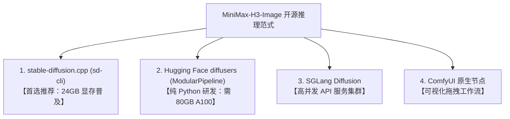

# 破局 1600 万像素与 6 步直出：MiniMax-H3-Image 纯开源架构深度拆解与 Colab 极速实战

> **摘要**：MiniMax 官方开源的生图模型 **MiniMax-H3-Image** 彻底打破了传统文生图领域的潜规则——它不仅单模型原生统一了「超高分辨率文生图（最高 1600 万像素 / 4096×4096）」与「多图精准指令级编辑（修图 / In-Context Edit）」，更通过 6 步 PDD 蒸馏将单次推理压缩到了极致。本文深入拆解其 33.1B DiT + 32B Qwen3-VL 的底层架构，解答「它真的必须绑死 ComfyUI 吗？」的技术疑问，并基于实测日志，给出如何在 Google Colab 便宜的 24GB L4 GPU 上以 `stable-diffusion.cpp` 免 Web 服务直出的完整避坑工作流。

---

## 一、 为什么 MiniMax-H3-Image 值得硬核关注？

在当下开源生图领域，大多数模型仍停留在 1024×1024 分辨率与 20~50 步慢速扩散采样的阶段，高分辨率往往依赖额外的 Upscaler 放大节点，而修图和一致性编辑则需要额外训练复杂的 ControlNet 或 IP-Adapter。

MiniMax-H3-Image 的开源直接给出了三个极具颠覆性的工程答案：

```
[MiniMax-H3-Image 全模态统一架构]
                    ┌───────────────────────────────┐
  Prompt / 文本 ───>│ Qwen3-VL-32B 语言视觉理解塔   │──┐
                    └───────────────────────────────┘  │
                    ┌───────────────────────────────┐  │ (隐层融合特征)
  参考图 <Picture 1>│ (提取第 50 层 Decoder 状态)   │──┤
  参考图 <Picture 2>│                               │  ▼
                    └───────────────────────────────┘ ┌──────────────────────────────────────────────┐
                                                      │ 33.1B Single-Stream DiT (50 Layers)          │
  初始高斯噪声 (Noise) ──────────────────────────────>│ - 56 Heads, FFN 14336, Hidden 5376           │
                                                      │ - 6 步 PDD (Progressive Distillation) 融合头 │
                                                      │ - CFG = 1.0 (单路推理，绝无负向 Prompt 开销) │
                                                      └──────────────────────────────────────────────┘
                                                                             │
                                                                             ▼
                                                      ┌──────────────────────────────────────────────┐
                                                      │ 2D ViT Image VAE (16x 下采样, 24 通道)       │
                                                      └──────────────────────────────────────────────┘
                                                                             │
                                                                             ▼
                                                      1600 万像素 (4K) 电影级成图 / 指令级编辑成果
```

### 1. 原生 1600 万像素（~16MP）超高清直出
绝非后置放大算法插值，其 DiT 空间建模原生支持从 1024×1024、2048×2048 一直到 **4096×4096（1:1）**、**5024×3360（3:2）**、**5472×3072（16:9）**。模型对微观材质（雨后湿岩板纹理、雪峰裂隙、杉木格栅透光）的解析力完全达到中画幅数码相机的锐度标杆。

### 2. 6 步 PDD 蒸馏，单路无 CFG（CFG=1.0）
传统模型跑图普遍需要 `CFG=3.0 ~ 7.5`，这意味着每一步去噪必须做 Conditional 与 Unconditional 两次前向计算（双倍算力消耗）。MiniMax-H3-Image 采用了 PDD（渐进式蒸馏）方案，并在输出端设计了专门的 `pdd_fused_heads`：
- **严格固定 6 步时间表**（Fixed Sigma 递减网格：`[1.0, 0.9675, 0.8875, 0.75, 0.5328, 0.2320, 0.0]`）；
- **CFG 强制锁定 1.0**，杜绝了负向提示词的双倍计算惩罚与色彩过曝失真。

### 3. 单模型原生统一「文生图」与「多图修图 / 指令编辑」
以往做局部修图或风格迁移，需要繁琐的 Mask 画布重绘或繁杂的 Adapter 堆叠。MiniMax-H3-Image 将图生图、风格迁移、主体替换、多图混合统一建模为上下文指令任务（In-Context Multi-Image Editing），最多原生支持 **16 张参考图**！

---

## 二、 核心答疑：这个模型有“修图”功能吗？怎么用？

**答案是：不仅有，而且是目前开源界最优雅的「自然语言上下文指代修图」（In-Context Image Editing）！**

在 MiniMax-H3-Image 中，你不需要去手动涂抹 Mask 蒙版，也不需要去反复调整 Denoise 强度，只需在 Prompt 中通过 `<Picture 1>`、`<Picture 2>` 占位符直接与参考图建立绑定语义。

### 1. 自然语言指令修图实测对比

在本项目的实测中，我们先由文本生成了一张「蓝调时刻被悬挂在雾气峡谷上空的现代极简玻璃茶室」，紧接着**直接将这张生成的成图作为 `<Picture 1>` 传入模型，下达季节与光影的精准重塑指令**：

| 模式 | 核心 Prompt 语法 | 实测成图效果 |
| :--- | :--- | :--- |
| **Demo 1: 文生图**<br>(4MP / 2048×2048) | `Editorial architectural photograph of a cantilevered glass tea pavilion suspended above a misty alpine canyon at blue hour. Warm amber lantern light glows through minimal cedar latticework, reflecting on a still infinity water basin...` |  |
| **Demo 2: 指令修图**<br>(基于 `<Picture 1>` 编辑) | `Transform the architectural scene in <Picture 1> into peak autumn at golden sunrise: surround the glass tea pavilion with vibrant crimson maple foliage, warm golden sunbeams piercing through the canyon mist, preserving the exact pavilion geometry and water reflection.` |  |

### 2. 修图核心机理与能力边界
- **结构与空间保持**：从实测对比图可以清晰看到，茶室的钢架悬臂几何形态、水平水池倒影、甚至远景山石的透视关系被严密继承；
- **全要素光影重塑**：冷色调的蓝调黎明（Blue Hour）被彻底转换为晨曦金光（Golden Sunrise），周边的雾气被金黄光束穿透，植被从深绿无缝换装为深红秋枫；
- **多图混合**：更可同时传入 `-r person.png -r background.png`，在提示词中写下 `"Place the person from <Picture 1> walking inside the tea pavilion of <Picture 2>"`，实现工业级的一致性合成。

---

## 三、 它一定要绑死 ComfyUI 吗？

**绝对不是！ComfyUI 只是官方为了生态推广封装的一个 GUI 壳，底层模型完全具备脱离 ComfyUI 的独立推理能力。**

目前社区已经形成了三大非 ComfyUI 纯开源运行范式：



1. **`stable-diffusion.cpp` (`sd-cli`)**（**本项目 Colab 默认主方案**）：
   - C++/CUDA 底层极致优化，支持 `int8_convrot` DiT 与 `Q4_K_M` GGUF 文本编码器；
   - 具备 `--offload-to-cpu` 和 `--vae-tiling` 分块机制，**将 650 亿参数（33.1B DiT + 32B VLM）完整塞进 24GB 显存的消费级/云端卡（L4 / RTX 4090）**；
   - 纯二进制 CLI 运行，完全没有 Python 依赖打架与 ComfyUI 服务崩溃的烦恼。
2. **Hugging Face `diffusers` (`ModularPipeline`)**：
   - PR `#15230` 已正式合并入官方 Diffusers main 分支，支持 `ComponentsManager` 模块化加载；
   - 但由于加载的是未经量化的 BF16 权重，即使开启 CPU Offload，峰值显存仍需 **~65 GB**，只适合 80GB A100/H100 用户。
3. **`SGLang Diffusion`**：
   - 针对多卡分布式部署与超高吞吐服务集群优化。

---

## 四、 Colab 实战工程避坑指南（L4 24GB）

在 Google Colab 免费赠送或低成本的 L4 GPU（1.94 CU/h）上跑这套系统，有三个至关重要的实测工程结论：

### 1. 为什么「直拉 Hugging Face」远快于「从 Google Drive 拷贝」？
很多开发者习惯将几十 GB 的模型放一份在 Google Drive 里以防重新下载。但在实际测试中发现：
- **Colab 实例与 Hugging Face 间的数据中心骨干网下行带宽通常在 100 ~ 300+ MB/s**，拉取 21GB 的主干模型仅需 **1~2 分钟**；
- 相反，Google Drive 的 FUSE 挂载（`/content/drive/MyDrive`）有严格的 API 配额与单线程吞吐限制，拷贝大文件常被限速在 **20~30 MB/s**，耗时 15 分钟以上且极易发生 I/O 挂起假死！
- **最佳分工**：模型权重直拉至本地 NVMe（`/content/models`）；而编译好的 ~20MB `sd-cli` 二进制与最终成图则写入 Google Drive。

### 2. 实测运行耗时存证（2048×2048 400 万像素）
在本次 Colab L4 (22.5GB 显存) 实跑中：
- **Demo 1 文生图（2048×2048）**：
  - 显存加载与 lazy 参数映射：~10s
  - 6 步 PDD 采样耗时：~130s
  - VAE Tiling 分块解码：~8.27s
  - **总耗时：157.8 秒（不到 2.7 分钟）**，消耗算力约 **0.085 CU**。
- **Demo 2 指令修图（基于 `<Picture 1>` 重塑）**：
  - 视觉塔（Vision Tower）特征提取与多模态对齐：~60s
  - 6 步采样与分块解码：~150s
  - **总耗时：226.1 秒（约 3.7 分钟）**，消耗算力约 **0.12 CU**。

---

## 五、 快速上手：一键 Colab 与本地脚本

本项目已提供完整的可执行工程：

1. **Colab 一键实跑 Notebook**：
   - [v4.0_minimax_h3_image_colab_demo.ipynb](notebooks/v4.0_minimax_h3_image_colab_demo.ipynb)（包含 2 小时看门狗防闲置扣费、CUDA 门禁、sd-cli 编译缓存秒级恢复、直拉权重与文生图/修图完整演示）。
2. **多后端 CLI 调度脚本**：
   - [scripts/demo_h3_image.py](scripts/demo_h3_image.py)（单文件支持 `--backend sdcpp`、`--backend comfyui`、`--backend diffusers`，默认自动启用 `sdcpp`）。

只需在终端一行命令即可复现修图实战：
```bash
python3 scripts/demo_h3_image.py \
  --backend sdcpp \
  --size 2048x2048 \
  --image outputs/demo1_t2i.png \
  --prompt "Transform the scene in <Picture 1> into a cyberpunk neon night market." \
  --output outputs/demo2_edit.png
```

MiniMax-H3-Image 的开源，标志着文生图与图生图正在从“拼参数与繁杂管道”迈向“原生多模态指令对齐与超高分辨率物理直出”。借由量化编译器与轻量工程架构，哪怕是在 24GB 显存的云端单卡上，高质量的工业级视觉创作也已触手可及。
