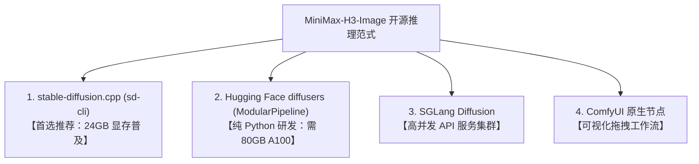

# 破局 1600 万像素与 6 步直出：MiniMax-H3-Image 纯开源架构深度拆解与 Colab 极速实战

> **摘要**：MiniMax 官方开源的生图模型 **MiniMax-H3-Image** 在单模型内原生统一了超高分辨率文生图（最高 1600 万像素 / 4096×4096）与多图指令级编辑（修图 / In-Context Edit），并结合 6 步 PDD 蒸馏实现单路无 CFG 快速推理。本文拆解其 33.1B DiT + 32B Qwen3-VL 底层架构与多引擎生态（`stable-diffusion.cpp` / `diffusers` / `ComfyUI`），并基于仓库 Colab 实测日志给出 L4 24GB 单卡免 Web 服务的 `sd-cli` 直出流程。

---

## 一、 MiniMax-H3-Image 的三大核心技术特性

在当下开源生图领域，大多数模型仍停留在 1024×1024 分辨率与 20~50 步慢速扩散采样的阶段，高分辨率往往依赖额外的 Upscaler 放大节点，而修图和一致性编辑则需要额外训练复杂的 ControlNet 或 IP-Adapter。

MiniMax-H3-Image 的开源直接给出了三个极具颠覆性的工程答案：

```
[MiniMax-H3-Image 全模态统一架构]
                    ┌───────────────────────────────┐
  Prompt / 文本 ───>│ Qwen3-VL-32B 文本编码器        │──┐
                    └───────────────────────────────┘  │
                    ┌───────────────────────────────┐  │ (隐层融合特征)
  参考图 <Picture 1>│ (提取第 50 层 Decoder 状态)   │──┤
  参考图 <Picture 2>│                               │  ▼
                    └───────────────────────────────┘ ┌──────────────────────────────────────────────┐
                                                      │ 33.1B Single-Stream DiT (50 Layers)          │
  初始高斯噪声 (Noise) ──────────────────────────────>│ - 56 Heads, FFN 14336, Hidden 5376           │
                                                      │ - 6 步 PDD (Progressive Distillation) 融合头 │
                                                      │ - CFG = 1.0 (单路推理，无负向 Prompt 开销)   │
                                                      └──────────────────────────────────────────────┘
                                                                             │
                                                                             ▼
                                                      ┌──────────────────────────────────────────────┐
                                                      │ 2D ViT Image VAE (16x 下采样, 24 通道)       │
                                                      └──────────────────────────────────────────────┘
                                                                             │
                                                                             ▼
                                                      1600 万像素 (~16MP) 原生高分辨率成图 / 指令编辑

### 1. 原生 1600 万像素（~16MP）高分辨率直出
DiT 空间建模原生支持从 1024×1024、2048×2048 一直到 **4096×4096（1:1）**、**5024×3360（3:2）**、**5472×3072（16:9）**，无需依赖后置放大模型插值即可保留雨后湿岩板纹理、雪峰裂隙与杉木格栅透光等微观材质细节。

### 2. 6 步 PDD 蒸馏，单路无 CFG（CFG=1.0）
传统模型跑图普遍需要 `CFG=3.0 ~ 7.5`，这意味着每一步去噪必须做 Conditional 与 Unconditional 两次前向计算（双倍算力消耗）。MiniMax-H3-Image 采用了 PDD（渐进式蒸馏）方案，并在输出端设计了专门的 `pdd_fused_heads`：
- **严格固定 6 步时间表**（Fixed Sigma 递减网格：`[1.0, 0.9675, 0.8875, 0.75, 0.5328, 0.2320, 0.0]`）；
- **CFG 强制锁定 1.0**，杜绝了负向提示词的双倍计算惩罚与色彩过曝失真。

### 3. 单模型原生统一「文生图」与「多图修图 / 指令编辑」
以往做局部修图或风格迁移，需要繁琐的 Mask 画布重绘或繁杂的 Adapter 堆叠。MiniMax-H3-Image 将图生图、风格迁移、主体替换、多图混合统一建模为上下文指令任务（In-Context Multi-Image Editing），最多原生支持 **16 张参考图**！

---

## 二、 核心答疑：这个模型有“修图”功能吗？怎么用？

**支持原生「自然语言上下文指代修图」（In-Context Image Editing）：**

在 MiniMax-H3-Image 中，你不需要手动涂抹 Mask 蒙版或反复试错 Denoise 强度，只需在 Prompt 中通过 `<Picture 1>`、`<Picture 2>` 占位符直接与参考图建立绑定语义。

### 1. 自然语言指令修图实测对比

在本项目的实测中，我们先由文本生成了一张「蓝调时刻被悬挂在雾气峡谷上空的现代极简玻璃茶室」，紧接着**直接将这张生成的成图作为 `<Picture 1>` 传入模型，下达季节与光影重塑指令**：

| 模式 | 核心 Prompt 语法 | 实测成图效果 |
| :--- | :--- | :--- |
| **Demo 1: 文生图**<br>(4MP / 2048×2048) | `Editorial architectural photograph of a cantilevered glass tea pavilion suspended above a misty alpine canyon at blue hour. Warm amber lantern light glows through minimal cedar latticework, reflecting on a still infinity water basin...` |  |
| **Demo 2: 指令修图**<br>(基于 `<Picture 1>` 编辑) | `Transform the architectural scene in <Picture 1> into peak autumn at golden sunrise: surround the glass tea pavilion with vibrant crimson maple foliage, warm golden sunbeams piercing through the canyon mist, preserving the exact pavilion geometry and water reflection.` |  |

### 2. 修图核心机理与适用场景
- **结构与空间保持**：从实测对比图可以清晰看到，茶室的钢架悬臂几何形态、水平水池倒影、甚至远景山石的透视关系被严密继承；
- **全要素光影重塑**：冷色调的蓝调黎明（Blue Hour）被彻底转换为晨曦金光（Golden Sunrise），周边的雾气被金黄光束穿透，植被从深绿无缝换装为深红秋枫；
- **多图混合**：更可同时传入 `-r person.png -r background.png`，在提示词中写下 `"Place the person from <Picture 1> walking inside the tea pavilion of <Picture 2>"`，实现工业级的一致性合成。

---

## 三、 它一定要绑死 ComfyUI 吗？

**不需要。ComfyUI 属于官方提供的可视化节点封装层，底层模型具备脱离 ComfyUI 的独立推理能力。**

目前社区已经形成了三大非 ComfyUI 纯开源运行范式：



1. **`stable-diffusion.cpp` (`sd-cli`)**（**本项目 Colab 默认主方案**）：
   - C++/CUDA 底层优化，支持 `int8_convrot` DiT（`19.54 GB`）与 `Q4_K_M` GGUF 文本编码器（`16.97 GB`）；
   - 配合 `--offload-to-cpu` 与 `--vae-tiling` 分块解码机制，**让原本百亿级的多模态架构稳定运行在 24GB 显存单卡（Colab L4 / RTX 4090）上**；
   - 纯二进制 CLI 运行，独立于 Python 环境与 Web 服务运行。
2. **Hugging Face `diffusers` (`ModularPipeline`)**：
   - PR `#15230` 已合入官方 Diffusers main 分支，支持 `ComponentsManager` 模块化加载；
   - 由于默认加载未经量化的 BF16 权重，即使开启 CPU Offload，峰值显存仍需 **~65 GB**，适合 80GB A100/H100 等高显存环境。
3. **`SGLang Diffusion`**：
   - 针对多卡分布式部署与高吞吐服务集群优化。

---

## 四、 Colab 实战工程避坑指南（L4 24GB）

在 Google Colab 按 CU 计费的 L4 GPU（历史面板实测约 `1.94 CU/h`，Colab Pro `$9.99/100 CU`、Pro+ `$49.99/600 CU`、Pay-As-You-Go `$9.99/100 CU`；核对日期：2026-11-12）上运行本方案时，以下三条实测结论直接影响体验与成本：

### 1. 为什么「直拉 Hugging Face」远快于「从 Google Drive 拷贝」？
直觉上不少人会将几十 GB 的模型提前存在 Google Drive 里以防重下，但在实测对比下：
- **Colab 实例与 Hugging Face 间的数据中心骨干网下行速率通常可达百 MB/s 级别**，拉取 `37.6 GB` 核心权重（`19.54 GB` DiT + `1.09 GB` VAE + `16.97 GB` GGUF）通常可在数分钟内完成；
- 相反，Google Drive 的 FUSE 挂载（`/content/drive/MyDrive`）受限于单线程与配额节流，读取数十 GB 大文件往往只有 **20~30 MB/s**，容易出现长时间阻塞；
- **推荐分工**：模型权重直拉至本地 NVMe（`/content/models`）；仅将编译产物（约 ~20MB `sd-cli` 二进制包，实测恢复 `<1s`）与最终成图持久化到 Google Drive。

### 2. 实测运行耗时存证（2048×2048 400 万像素）
在仓库 `v4_0` Colab L4 (`22.5 GB` 显存, `sm_89`) 实跑日志中：
- **Demo 1 文生图（2048×2048，6 步 PDD，`CFG=1.0`）**：
  - 核心生成步骤（`generate_image`）：`149.09s`
  - VAE Tiling 分块解码：`8.27s`
  - **总耗时：`157.8 秒`（约 2.6 分钟）**，按 `1.94 CU/h` 折算约 **`0.085 CU`**。
- **Demo 2 指令修图（2048×2048，基于 `<Picture 1>` 重塑）**：
  - 核心生成步骤（`generate_image` 含视觉特征编码）：`217.53s`
  - VAE 分块解码：`9.93s`
  - **总耗时：`226.1 秒`（约 3.8 分钟）**，按 `1.94 CU/h` 折算约 **`0.122 CU`**。

*(注：若在 Colab 使用后无需继续排查成图，记得手动断开运行时或把 Notebook 中的 `AUTO_SHUTDOWN` 设为 `True`，避免持续计费。)*

---

## 五、 快速上手：一键 Colab 与本地脚本

本项目已提供完整的可执行工程：

1. **Colab 生产模板与实测存证 Notebook**：
   - [notebooks/v4.0_minimax_h3_image_colab_demo.ipynb](../../notebooks/v4.0_minimax_h3_image_colab_demo.ipynb)（干净模板；含 2 小时看门狗、CUDA 门禁、sd-cli 缓存秒级恢复与文生图/修图完整演示）；
   - [notebooks/v4_0_minimax_h3_image_colab_demo.ipynb](../../notebooks/v4_0_minimax_h3_image_colab_demo.ipynb)（实测存证版，保留了 `157.8s` 与 `226.1s` 云端运行完整日志）。
2. **多后端 CLI 调度脚本**：
   - [scripts/demo_h3_image.py](../../scripts/demo_h3_image.py)（支持 `--backend sdcpp`、`--backend comfyui`、`--backend diffusers`，默认启用 `sdcpp`）。

在 Colab 环境可直接运行以下指令复现修图实战（本地运行请追加 `--sd-cli`、`--sd-diffusion-model`、`--sd-vae`、`--sd-llm` 指向本地文件路径）：
```bash
python3 scripts/demo_h3_image.py \
  --backend sdcpp \
  --size 2048x2048 \
  --image outputs/demo1_t2i.png \
  --prompt "Transform the scene in <Picture 1> into a cyberpunk neon night market." \
  --output outputs/demo2_edit.png
```

MiniMax-H3-Image 的开源使 16MP 级高分辨率生图与自然语言指令修图可以在单张 24GB 显卡上以纯开源工具链独立运行；结合量化推理与轻量 CLI 编排，创作者能够在可控算力预算内直接落地图像生成与编辑工作流。

## 「MiniMax H3 实战」全系列导航

- [第一篇：技术选型：海螺 3.0 处于什么水平？核心指标与横向对比](01-introduction-and-principles.md)
- [第二篇：流程落地：我们跑通的基准工作流与关键参数影响](02-timeline-prompting.md)
- 第三篇：图像与指令编辑：`MiniMax-H3-Image` 纯开源架构拆解与 Colab `sd.cpp` 实战（本文）

## 原文对照与参考文献

1. [MiniMax 官方图像模型技术仓库：`MiniMax-AI/MiniMax-H3-Image`（商业应用授权请参见官方协议）](https://huggingface.co/MiniMaxAI/MiniMax-H3-Image)
2. [ComfyUI 官方 MiniMax 生态文档：`docs.comfy.org`](https://docs.comfy.org/tutorials/video/minimax/minimax-h3)
3. [Hugging Face Diffusers 模块化合入：`ModularPipeline` PR #15230](https://github.com/huggingface/diffusers/pull/15230)
4. [本仓库事实台账与 `v4_0` L4 实测存证：`docs/minimax-h3-facts-2026-11-12.md`](../minimax-h3-facts-2026-11-12.md)
