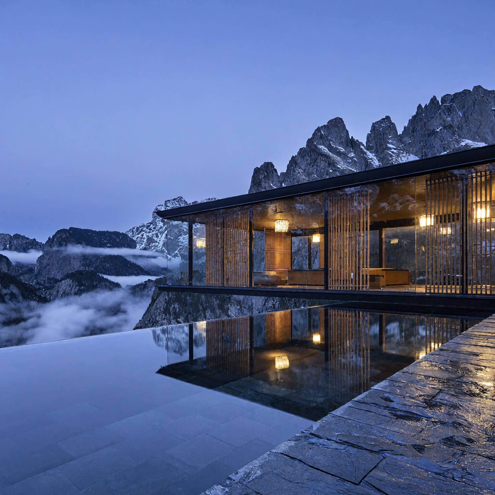
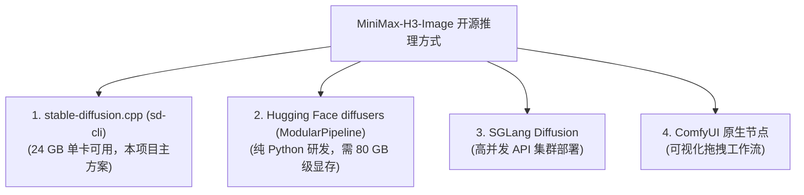

# 图像与指令编辑：MiniMax-H3-Image 纯开源架构拆解与 Colab `sd.cpp` 实战

> 开源生图模型常见两件事不够顺手：超过 1024×1024 就得外挂放大模型补像素，想改图里的局部光影或换背景还得自己画 Mask 蒙版。MiniMax 开源的 `MiniMax-H3-Image` 把高分辨率文生图和多图上下文修图放进了同一个模型里，并用 6 步 PDD 蒸馏跑单路推理。
>
> 本文是「MiniMax H3（海螺 3.0）实战」系列的第三篇，拆解 `33.1B DiT + Qwen3-VL-32B` 的推理结构，并基于本仓库 Colab L4 实测日志，演示如何脱离 ComfyUI，用 `stable-diffusion.cpp`（`sd-cli`）在 24 GB 单卡上跑通文生图与指令修图。

## MiniMax-H3-Image 的三项核心特性

大多数开源生图模型默认工作在 `1024×1024` 分辨率与 20 到 50 步采样区间，拉高像素通常依赖额外的放大器（Upscaler），改图要叠加 ControlNet 或重绘蒙版。`MiniMax-H3-Image` 在底层的处理方式如下：

```
[MiniMax-H3-Image 全模态统一架构]
                    ┌───────────────────────────────┐
  Prompt / 文本 ───>│ Qwen3-VL-32B 文本编码器        │──┐
                    └───────────────────────────────┘  │
                    ┌───────────────────────────────┐  │ (隐层融合特征)
  参考图 <Picture 1>│ (提取第 50 层 Decoder 状态)   │──┤
  参考图 <Picture 2>│                               │  ▼
                    └───────────────────────────────┘ ┌──────────────────────────────────────────────┐
                                                      │ 33.1B Single-Stream DiT (50 Layers)          │
  初始高斯噪声 (Noise) ──────────────────────────────>│ - 56 Heads, FFN 14336, Hidden 5376           │
                                                      │ - 6 步 PDD (Progressive Distillation) 融合头 │
                                                      │ - CFG = 1.0 (单路推理，无负向 Prompt 开销)   │
                                                      └──────────────────────────────────────────────┘
                                                                             │
                                                                             ▼
                                                      ┌──────────────────────────────────────────────┐
                                                      │ 2D ViT Image VAE (16x 下采样, 24 通道)       │
                                                      └──────────────────────────────────────────────┘
                                                                             │
                                                                             ▼
                                                      原生最高 ~16MP 高分辨率成图 / 指令编辑
```

### 1. 支持最高 ~16MP（1600 万像素）原生直出

DiT 空间建模原生支持从 `1024×1024`、`2048×2048` 到 **4096×4096（1:1）**、**5024×3360（3:2）** 与 **5472×3072（16:9）** 的多挡规格，架构层面无需先出小图再插值放大。不过分辨率拉得越高，显存分块解码开销与生成耗时也会明显上升（在 24 GB 单卡上本项目优先验证了 `2048×2048` 档位）。

### 2. 6 步 PDD 蒸馏与单路无引导（CFG=1.0）

传统生图模型普遍设 `CFG=3.0 ~ 7.5`，每一步去噪都要算两遍前向传播。`MiniMax-H3-Image` 采用 PDD（渐进式蒸馏），在输出端配置了专门的 `pdd_fused_heads`：

- 固定 6 步 Sigma 递减时间表：`[1.0, 0.9675, 0.8875, 0.75, 0.5328, 0.2320, 0.0]`；
- 引导强度锁定 `CFG=1.0`，省掉负向分支的计算开销与过曝发偏风险。

### 3. 单模型统一文生图与多图指令修图

做局部修改或跨图合成时，模型把图生图、风格切换和主体融合统一成了上下文指令任务（In-Context Multi-Image Editing），最多支持同时传入 **16 张参考图**。

## 原生指令修图怎么用

在 `MiniMax-H3-Image` 里修图不需要手动涂抹 Mask 或调 Denoise 强度，直接在 Prompt 中用 `<Picture 1>`、`<Picture 2>` 占位符指代传入的参考图即可。

我们在仓库测试里先用文字生成了一张「蓝调时刻悬挂在雾气峡谷上空的玻璃茶室」，接着直接把这张成图作为 `<Picture 1>` 喂回模型，继续让它把季节和光线改掉：

| 模式 | 核心 Prompt 写法 | 实测成图效果 |
| :--- | :--- | :--- |
| **Demo 1: 文生图**<br>(4MP / `2048×2048`) | `Editorial architectural photograph of a cantilevered glass tea pavilion suspended above a misty alpine canyon at blue hour. Warm amber lantern light glows through minimal cedar latticework, reflecting on a still infinity water basin...` |  |
| **Demo 2: 指令修图**<br>(基于 `<Picture 1>` 修改) | `Transform the architectural scene in <Picture 1> into peak autumn at golden sunrise: surround the glass tea pavilion with vibrant crimson maple foliage, warm golden sunbeams piercing through the canyon mist, preserving the exact pavilion geometry and water reflection.` |  |

从对比图可以看到三个变化特征：

- **结构与透视保持**：茶室的悬臂钢架形态、水面倒影和远景山石位置基本没有走样；
- **全局光影与季节重绘**：蓝调晨光换成了早晨的金色阳光，雾气穿过暖光束，周围绿植替换成红叶；
- **多图合成能力**：支持同时传入多张参考图（例如 `-r person.png -r background.png`），在提示词里写 `"Place the person from <Picture 1> walking inside the tea pavilion of <Picture 2>"`，把人物直接合进目标场景里。

## 不依赖 ComfyUI 的三种运行方式

不需要把工作流绑死在 ComfyUI 上。ComfyUI 只是可视化节点前端，底层模型本身具备多种独立运行方式：



1. **`stable-diffusion.cpp` (`sd-cli`)**（本项目 Colab 主方案）：用 C++/CUDA 跑 `int8_convrot` DiT（`19.54 GB`）和 `Q4_K_M` GGUF 文本编码器（`16.97 GB`），打开 `--offload-to-cpu` 与 `--vae-tiling` 分块解码后，可以稳跑在 24 GB 单卡（Colab L4 或 RTX 4090）上，且完全脱离 Python Web 服务。
2. **Hugging Face `diffusers` (`ModularPipeline`)**：PR `#15230` 已合入官方主干，支持 `ComponentsManager` 模块化调用；默认加载未经量化的 BF16 权重，即便打开 CPU Offload 峰值显存仍要约 `65 GB`，主要面向 80 GB A100/H100 环境。
3. **`SGLang Diffusion`**：针对多卡并发推理和服务吞吐优化的部署方案。

## Colab L4 实测耗时与权重缓存策略

在 Google Colab L4（`22.5 GB` 可用显存、`sm_89`，本仓库历史面板校准基线 `1.94 CU/h`）上跑 `v4_0` 实测时，有两组工程数据值得注意。

### 为什么大权重直拉 Hugging Face 比从 Drive 拷更快

不少人习惯先把几十 GB 模型塞进 Google Drive 以防每次重下，但实际测试下来速度差距很大：

- **Colab 到 Hugging Face 直拉**：数据中心骨干网下行速率常在百 MB/s 级别，拉取 `37.6 GB` 核心权重（`19.54 GB` DiT + `1.09 GB` VAE + `16.97 GB` GGUF）几分钟就能就绪；
- **Google Drive 挂载读取**：`/content/drive/MyDrive` 走 FUSE 挂载，大文件读取常被限在 `20~30 MB/s`，反复读取大权重反而更慢。

合理分工是：大权重直接拉到实例本地 NVMe（`/content/models`），只把编译好的 `sd-cli` 二进制包（约 `20 MB`，实测从 Drive 恢复耗时 `<1s`）和生成的图片存进 Google Drive。

### `2048×2048` 实测耗时记录

在仓库 [v4_0_minimax_h3_image_colab_demo.ipynb](../../notebooks/v4_0_minimax_h3_image_colab_demo.ipynb) 的实跑日志里：

- **Demo 1 文生图（`2048×2048`，6 步 PDD，`CFG=1.0`）**：`generate_image` 耗时 `149.09s`，VAE Tiling 分块解码 `8.27s`，**总计 `157.8 秒`（约 2.6 分钟）**，按 `1.94 CU/h` 折算约 `0.085 CU`。
- **Demo 2 指令修图（`2048×2048`，基于 `<Picture 1>` 修改）**：`generate_image`（含参考图视觉编码）耗时 `217.53s`，VAE 分块解码 `9.93s`，**总计 `226.1 秒`（约 3.8 分钟）**，按 `1.94 CU/h` 折算约 `0.122 CU`。

Colab 出图结束后记得及时断开运行时，或者把模板中的 `AUTO_SHUTDOWN` 设为 `True`，免得实例在后台一直扣 CU。

## 一键 Colab 与本地运行方式

仓库已经整理好可直接执行的笔记本和调度脚本：

- **Colab 笔记本**：[干净生产模板 `v4.0`](../../notebooks/v4.0_minimax_h3_image_colab_demo.ipynb)（含 2 小时看门狗、CUDA 门禁、Drive 二进制秒级恢复与文生图/修图完整单元）与 [实测存证版 `v4_0`](../../notebooks/v4_0_minimax_h3_image_colab_demo.ipynb)（保留了 `157.8s` 和 `226.1s` 完整输出日志）。
- **多后端 CLI 脚本**：[scripts/demo_h3_image.py](../../scripts/demo_h3_image.py)（支持 `--backend sdcpp`、`comfyui`、`diffusers`，无 GPU 时可加 `--dry-run` 校验拼装参数）。

在 Colab 中可直接执行下面的命令复现修图流程（本地环境运行请补充 `--sd-cli`、`--sd-diffusion-model`、`--sd-vae`、`--sd-llm` 指向本地文件路径）：

```bash
python3 scripts/demo_h3_image.py \
  --backend sdcpp \
  --size 2048x2048 \
  --image outputs/demo1_t2i.png \
  --prompt "Transform the scene in <Picture 1> into a cyberpunk neon night market." \
  --output outputs/demo2_edit.png
```

想继续查看参数细节或下载校验脚本，可以直接看 [工程仓库总览](../../README.md) 与 [2026-11-12 核验事实台账](../minimax-h3-facts-2026-11-12.md)。

## MiniMax-H3-Image 常见问题

### 24 GB 显存单卡能直接跑 1600 万像素（4096×4096）吗？

模型架构原生最高支持约 16MP（如 `4096×4096`、`5472×3072`），但我们在 24 GB Colab L4 上实测存证的稳定档位是 `2048×2048`（`157.8s` 文生图、`226.1s` 修图）。在 24 GB 卡上挑战更高像素高度依赖 `--offload-to-cpu` 与 `--vae-tiling` 分块，显存腾挪和耗时都会明显放大，本仓库尚未记录 `4096×4096` 在 L4 上的完整耗时日志。

### 用 `<Picture 1>` 修图和以前用 ControlNet、画 Mask 有什么区别？

不需要提前抠蒙版，也不用在局部重绘强度上反复试错。`Qwen3-VL-32B` 会一起读进参考图和修改指令，适合改季节光影、换背景以及多图合成；但如果是像素级精修单个微小字样，纯自然语言指令仍不如人工精修蒙版精准。

### `MiniMax-H3-Image` 可以直接商用吗？

商业授权范围与区域限制以模型仓库中的官方协议文件为准（详见 Hugging Face `MiniMaxAI/MiniMax-H3-Image` 页面，请勿直接套用视频模型仓库的协议正文，使用前先逐条核对当前文件）。

## 「MiniMax H3（海螺 3.0）实战」全系列导航

- [第一篇：MiniMax H3（海螺 3.0），开源视频生成模型，技术定位与选型对比](01-introduction-and-principles.md)
- [第二篇：流程落地：我们跑通的基准工作流，与关键参数的决定性影响](02-timeline-prompting.md)
- 第三篇：图像与指令编辑：`MiniMax-H3-Image` 纯开源架构拆解与 Colab `sd.cpp` 实战（本文）

## 项目开源仓库

本文对应的 `sd.cpp` CLI 脚本、Colab L4 Notebook 与实测日志均已开源：

- GitHub 仓库：[https://github.com/kuhung/minimax-h3-colab-workflow](https://github.com/kuhung/minimax-h3-colab-workflow)

## 原文对照与参考文献

*(文中实测耗时、显存占用与 Colab CU 费率基线均核对自 2026-11-12，实际计费与协议条款以各官网及 Colab 实时面板为准。)*

1. [MiniMax 官方图像模型技术仓库：`MiniMaxAI/MiniMax-H3-Image`](https://huggingface.co/MiniMaxAI/MiniMax-H3-Image)
2. [ComfyUI 官方 MiniMax 生态文档：`docs.comfy.org`](https://docs.comfy.org/tutorials/video/minimax/minimax-h3)
3. [Hugging Face Diffusers 模块化合入：`ModularPipeline` PR #15230](https://github.com/huggingface/diffusers/pull/15230)
4. [本仓库事实台账与 `v4_0` L4 实测存证：`docs/minimax-h3-facts-2026-11-12.md`](../minimax-h3-facts-2026-11-12.md)
